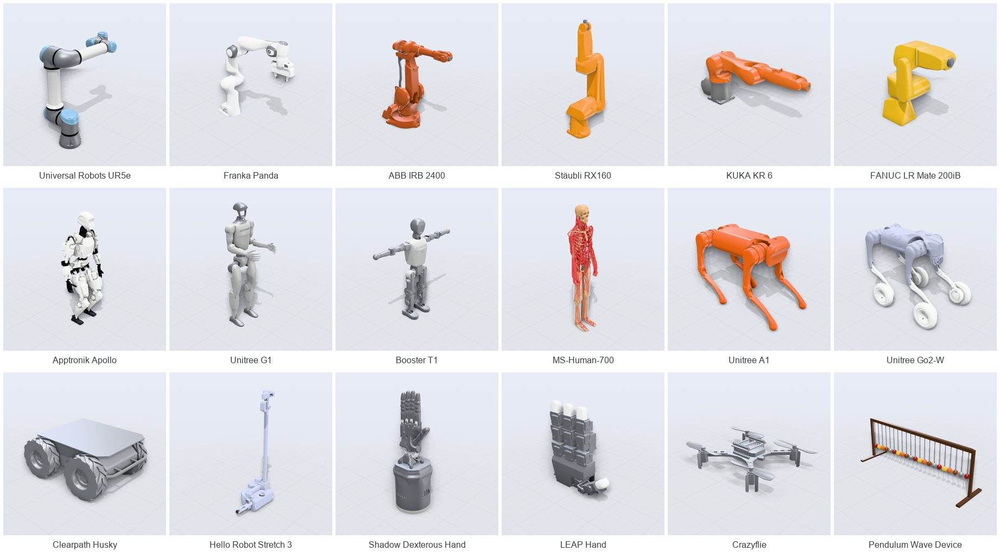

<p align="center">
  
</p>

<h1 align="center">Robot Studio</h1>

<p align="center">
  Build, analyze, simulate and take apart serial robots, in the browser.<br>
  Live kinematics, MuJoCo physics compiled to WebAssembly, and teardown views of the hardware. There is no server.
</p>

<p align="center">
  <a href="https://robotics-studio-one.vercel.app"><b>Open the live studio</b></a>
  &nbsp;·&nbsp; <a href="#robot-library">Robot library</a>
  &nbsp;·&nbsp; <a href="#run-it-locally">Run locally</a>
</p>

<p align="center">
  <a href="https://robotics-studio-one.vercel.app"></a>
  <a href="https://github.com/batuhantoker/robot-studio/actions/workflows/ci.yml"></a>
  
  
  
  
</p>

<p align="center">
  <a href="https://robotics-studio-one.vercel.app"></a>
  <br><sub>MuJoCo (WebAssembly) drives the <code>spatial_6link</code> preset through a quintic trajectory; applied torque and tracking error plot live. <a href="https://robotics-studio-one.vercel.app">Try it in your browser.</a></sub>
</p>

You build an arm from a catalogue of joints, or open one of 162 robots: arms,
humanoids, legged and wheeled machines, many from real CAD. The studio poses them,
explains their kinematics with live numbers, simulates them in MuJoCo, drives them
around a workshop, and takes them apart teardown-style. MuJoCo is the official
WebAssembly build (`@mujoco/mujoco`), so everything runs client-side, on a desktop or
a phone.

**Try it now at [robotics-studio-one.vercel.app](https://robotics-studio-one.vercel.app).** It needs no install and no
account, and runs in any modern browser with WebGL.

## A look inside

<table>
  <tr>
    <td width="50%" valign="top">
      
      <b>Pose and inspect.</b> Every joint shows its angle and its torque against the motor
      limit. Dexterity and the tool pose update live, and FK is checked against MuJoCo.
      The modes sit along the top; the current mode's controls sit under the robot.
    </td>
    <td width="50%" valign="top">
      
      <b>Live math.</b> The chain product, Rodrigues' formula, FK, a DH table derived from
      the axis geometry, and the Jacobian SVD, all evaluated at the current pose.
    </td>
  </tr>
  <tr>
    <td width="50%" valign="top">
      
      <b>Teardown.</b> The View menu (the eye over the stage) switches to glass housings that
      show the drives inside, and Explode opens every joint along its own axis.
    </td>
    <td width="50%" valign="top">
      
      <b>Bill of parts.</b> Isolate a module to list its parts by layer, with callouts.
      This one is the shoulder actuator: housing, stator, windings, magnet rotor,
      strain-wave gear.
    </td>
  </tr>
  <tr>
    <td width="50%" valign="top">
      
      <b>Workspace and limits.</b> The reachable shell is sampled in joint space and
      coloured by dexterity, torque, joint-limit margin or reach. The Analysis tab follows
      the mode: here it gives volume, reach and the near-singular share.
    </td>
    <td width="50%" valign="top">
      
      <b>Real robot CAD.</b> The studio loads Menagerie, ARMOR-gallery and SolidWorks
      robots and extracts their serial chain for the same math. Shown: Franka Emika Panda
      from MuJoCo Menagerie (Apache-2.0).
    </td>
  </tr>
  <tr>
    <td width="50%" valign="top">
      
      <b>Drive, reach and grab.</b> Pilot walks legged robots and drives wheeled ones. On a
      humanoid, Hands steers each hand to a part on the bench, grips it, and carries it off.
      Shown: Unitree G1 in the lab setting.
    </td>
    <td width="50%" valign="top">
      
      <b>Several robots on one stage.</b> Add up to four, place each by arrows or by
      millimetres and degrees, and click any of them to take control.
    </td>
  </tr>
</table>

<p align="center">
  
  <br><sub>On a phone: the stage with the mode's bar, every mode as a card, panels as bottom sheets, and the walkthrough.</sub>
</p>

## Run it locally

To skip the install, open the same build at [robotics-studio-one.vercel.app](https://robotics-studio-one.vercel.app).

```bash
npm install
npm run dev              # http://localhost:5173
npm run robots:fetch     # optional: real robot CAD, kept on this machine (see Robot CAD)
```

`npm test` runs the cross-validation suite, `npm run typecheck` checks types, and
`npm run build` writes a static site to `dist/`.

## Getting around


- **Top bar:** the robot's name opens the library, and the eight modes sit in the
  middle: Pose, Motion, Pilot, Pick & place, IK, Trajectory, Physics, Workspace. On a
  phone, one button opens every mode as a card.
- **Under the robot:** one bar for the current mode, such as motion presets,
  trajectory stops, Pilot keys and hands, or pick and place.
- **Top right of the stage:** the robots on the stage (up to four), the View menu
  (looks, cutaways, explode, overlays, isolate a part) and the surroundings.
- **Side panels** (bottom sheets on phones): Robots and Build on the left; Live, Math
  and Analysis on the right. Analysis shows the current mode's tools. `[` and `]` fold
  the panels to a rail of icons.
- **`?` starts a walkthrough:** it spotlights each of these on the real screen, one
  line at a time, switching modes and opening menus to show them. Other keys: `/`
  searches the robots, and `↑ ↓` steps through them.

## What it does

- **Build robots from a joint catalogue.** There are six joint kinds: revolute,
  prismatic, cylindrical (slide plus turn), universal (two intersecting hinges),
  spherical (three intersecting hinges) and planar (two slides plus a turn).
  - Each kind expands into elementary hinge and slide DOFs, so FK, the Jacobian, DH,
    IK, statics and MuJoCo treat them all the same way.
  - Each kind has its own procedural CAD module: a cobot actuator with stator,
    windings, magnet rotor, strain-wave gear, bearings and encoder; a ball-screw axis;
    a telescoping sleeve; a Cardan yoke; a ball and socket; an XY stage.
  - Robots are saved in the browser and export as Python JSON, studio JSON or MJCF.
- **15 presets, ready to pose and edit.**
  - Five real arms are built from their published DH tables, and a test checks each
    against its table: UR5e, Franka Panda, KUKA iiwa 14, ABB IRB 120 and PUMA 560.
  - Classic layouts: a SCARA and the Stanford arm with its telescoping boom.
  - Newer machines: a home-robot mobile manipulator, LeRobot's SO-101 and a
    humanoid arm with spherical shoulder and wrist.
  - Sources are listed in [`presets/studio`](presets/studio/README.md).
- **Humanoids and multi-limb robots.** Every limb is live. The focus picker in the top
  bar chooses which limb the math explains, and whole-body IK moves several end
  effectors at once.
- **Pilot.** Drive a legged or wheeled robot with `W A S D` (`Q E` side-steps, `Shift`
  hurries, `C` swaps the follow and look-out cameras), or with an on-screen stick on a
  phone. It stops short of the scenery.
  - Hands, on humanoids: pick a hand, move its target with the pad or `I J K L` /
    `U O`, grip with `Space`, and carry the part off; `R` rests the hands.
  - Hand moves on keys `1`–`4`: wave, reach, work, lift.
- **Pick and place.** Choose the pick and place spots by dragging arrows or clicking the
  floor or a bench; the plan says what blocks it. It starts from a loose part in reach.
- **Several robots on one stage.** Up to four, each placed in the stage frame; click one
  to control it. One MuJoCo heap holds them all, so the page caps the count.
- **Motion.** One-click motions matched to the loaded robot:
  - circle, figure 8 and pick-and-place for arms;
  - trot, walk or tripod gaits for legged robots;
  - march, squat, wave and reach for humanoids;
  - drive or spin for wheeled and aerial robots;
  - a joint wave for anything.
- **Teardown.** The View menu (the eye over the stage) switches between solid, glass
  and section views, and holds the looks (studio, clay, technical, materials) and the
  overlays (axes, CoM, velocity ellipsoid, trail, workspace).
  - Section cuts the robot with a plane you place: side, front or top, slid across it.
    Cut faces close as solid caps, a ghost keeps the half cut away, and the near half is
    always the one removed, from any angle.
  - The explode control opens each joint along its own axis.
  - Isolating a module shows its bill of parts, layered callouts with leaders, and a
    load ring that glows with |τ|/τ_max.
  - The workspace overlay works in every mode. Outside Workspace mode it shows the focused
    limb's reach, a humanoid's hand rather than its whole body.
  - Auto tour (top right) walks through these views. Any input ends it and puts the view back.
  - Left idle for 25 seconds, the camera circles slowly and whatever is running keeps running.
    Moving the mouse swings it back to where you left it.
- **Surroundings.** The gear on the viewport picks a backdrop (studio, cyclorama, dusk,
  dark, blueprint), a floor (grid, seamless, polished, tiles, none) and a setting: open
  floor, a desk, a lab bench, a work cell with a fence and a conveyor, a machine shop,
  or a warehouse. Each setting has loose parts to pick up, and its conveyors and
  vehicles can run.
- **Math tab.** Every section is evaluated at the current pose:
  - the chain product and Rodrigues' formula;
  - forward kinematics;
  - a DH table derived from the axis geometry (skew, intersecting, parallel and
    coincident cases) and verified against FK;
  - the geometric Jacobian with SVD, manipulability and condition number;
  - the damped-least-squares IK trace;
  - gravity statics as Jacobian-transpose sums;
  - the quintic profile;
  - the original Kane closed form, shown for `original_4dof`;
  - the equations of motion and the control law.
- **Analysis tab.** It shows the current mode's tools and lists the others as cards.
  - IK against a draggable target, with the solver iterations replayed.
  - Quintic trajectories with joint, speed and torque profiles. Render one pass to a
    16:9 MP4 (720p to 4K, 30 or 60 fps), drawn offline frame by frame with AO and
    supersampling, or export the samples (t, q, qd, qdd, tool path) as CSV or JSON.
  - A control lab on every robot: MuJoCo tracks the motion under PID torque control
    and scores each run. Tune every joint's gains by hand, then let policy gradient
    or cross-entropy learn them from the score alone, live in the browser. Robots on
    legs or wheels sit on a test stand for now, so this tunes joints, not balance.
  - Workspace and limits, as described above.
- **Real robot CAD.** Imported robots render from MuJoCo's compiled meshes, and their
  serial chain is extracted for the same math. In glass view each body shows MuJoCo's
  equivalent-inertia box.
  - **Make editable** turns a CAD robot into a *kinematic twin*: a studio spec with
    the same FK, built from zero-pose axes and anchors (product of exponentials).
  - The real meshes stay bound to the twin's links. Changing a length slice-stretches
    only the middle of the link, so housings keep their shape. Thickness scales the
    cross-section.
  - Links whose joint kind or direction you change, and links you add, fall back to
    procedural modules.

## Robot library

<p align="center">
  
</p>

<!-- robot-library:start -->
**162 robots** from 71 makers. Click a name to open that robot in the live studio. 17 models whose upstream states no license are not published: `npm run robots:fetch` builds them on your own machine.

<details>
<summary><b>Studio presets</b> (15)</summary>

| Robot | Maker | Joints | License |
|---|---|--:|---|
| [humanoid_arm](https://robotics-studio-one.vercel.app/?robot=preset:humanoid_arm) | Studio | 7 | — |
| [iiwa14](https://robotics-studio-one.vercel.app/?robot=preset:iiwa14) | Studio | 7 | — |
| [irb120](https://robotics-studio-one.vercel.app/?robot=preset:irb120) | Studio | 6 | — |
| [mobile_manipulator](https://robotics-studio-one.vercel.app/?robot=preset:mobile_manipulator) | Studio | 8 | — |
| [original_4dof](https://robotics-studio-one.vercel.app/?robot=preset:original_4dof) | Studio | 4 | — |
| [panda](https://robotics-studio-one.vercel.app/?robot=preset:panda) | Studio | 7 | — |
| [planar_2link](https://robotics-studio-one.vercel.app/?robot=preset:planar_2link) | Studio | 2 | — |
| [puma560](https://robotics-studio-one.vercel.app/?robot=preset:puma560) | Studio | 6 | — |
| [scara](https://robotics-studio-one.vercel.app/?robot=preset:scara) | Studio | 4 | — |
| [so101](https://robotics-studio-one.vercel.app/?robot=preset:so101) | Studio | 5 | — |
| [spatial_3link](https://robotics-studio-one.vercel.app/?robot=preset:spatial_3link) | Studio | 3 | — |
| [spatial_6link](https://robotics-studio-one.vercel.app/?robot=preset:spatial_6link) | Studio | 6 | — |
| [spatial_12link](https://robotics-studio-one.vercel.app/?robot=preset:spatial_12link) | Studio | 12 | — |
| [stanford_arm](https://robotics-studio-one.vercel.app/?robot=preset:stanford_arm) | Studio | 6 | — |
| [ur5e](https://robotics-studio-one.vercel.app/?robot=preset:ur5e) | Studio | 6 | — |

</details>

<details>
<summary><b>Arms</b> (67)</summary>

| Robot | Maker | Joints | License |
|---|---|--:|---|
| [ABB GoFa CRB 15000](https://robotics-studio-one.vercel.app/?robot=cad:armor-abb-crb15000) | ABB | 6 | [Apache-2.0](https://github.com/ros-industrial/abb/tree/45f4769d826cf3ac62a65495f2db67b78b0c81df/abb_crb15000_support/urdf) |
| [ABB IRB 120](https://robotics-studio-one.vercel.app/?robot=cad:armor-abb-irb120) | ABB | 6 | [Apache-2.0](https://github.com/ros-industrial/abb/tree/45f4769d826cf3ac62a65495f2db67b78b0c81df/abb_irb120_support/urdf) |
| [ABB IRB 2400](https://robotics-studio-one.vercel.app/?robot=cad:armor-abb-irb2400) | ABB | 8 | [Apache-2.0](https://github.com/ros-industrial/abb/tree/45f4769d826cf3ac62a65495f2db67b78b0c81df/abb_irb2400_support/urdf) |
| [ABB IRB 4600](https://robotics-studio-one.vercel.app/?robot=cad:armor-abb-irb4600) | ABB | 6 | [Apache-2.0](https://github.com/ros-industrial/abb/tree/45f4769d826cf3ac62a65495f2db67b78b0c81df/abb_irb4600_support/urdf) |
| [ABB IRB 6640](https://robotics-studio-one.vercel.app/?robot=cad:armor-abb-irb6640) | ABB | 6 | [Apache-2.0](https://github.com/ros-industrial/abb/tree/45f4769d826cf3ac62a65495f2db67b78b0c81df/abb_irb6600_support/urdf) |
| [ABB IRB 6700](https://robotics-studio-one.vercel.app/?robot=cad:armor-abb-irb6700) | ABB | 8 | [Apache-2.0](https://github.com/ros-industrial/abb/tree/45f4769d826cf3ac62a65495f2db67b78b0c81df/abb_irb6700_support/urdf) |
| [ABB YuMi](https://robotics-studio-one.vercel.app/?robot=cad:armor-abb-yumi) | ABB | 14 | [BSD-2-Clause](https://github.com/ethz-asl/yumi/tree/d3057997d82ecdf753ec14b0c131b5aee5e11e44/yumi_description/urdf) |
| [AgileX PiPER](https://robotics-studio-one.vercel.app/?robot=cad:armor-agilex-piper) | AgileX Robotics | 8 | [MIT](https://github.com/agilexrobotics/piper_ros/tree/ac41fcbcdda598f01b51cf6175ed9a24d0dacadc/src/piper_description/urdf) |
| [Dobot CR5](https://robotics-studio-one.vercel.app/?robot=cad:armor-dobot-cr5) | Dobot | 6 | [MIT](https://github.com/Dobot-Arm/TCP-IP-ROS-6AXis/tree/0924e785f1827b7125ba4ba2bc3325811ed21c18/dobot_description/urdf) |
| [Doosan Robotics M1013](https://robotics-studio-one.vercel.app/?robot=cad:armor-doosan-m1013) | Doosan Robotics | 6 | [BSD-3-Clause](https://github.com/doosanrobotics/doosan-robot2/tree/d276f9f9712118a18bad1d9ee1d7d4eab10a4ea8/dsr_description2/urdf) |
| [Enactic OpenArm v2.0](https://robotics-studio-one.vercel.app/?robot=cad:armor-openarm) | Enactic | 18 | [Apache-2.0](https://github.com/enactic/openarm_description/tree/10ca9bf2f49ef93a2f0f83f97ed2c0fb42dd9a90/assets/robot/openarm_v2.0/urdf/example) |
| [Epson C8-C901S](https://robotics-studio-one.vercel.app/?robot=cad:armor-epson-c8-c901s) | Epson Robots | 6 | [Apache-2.0](https://github.com/Epson-Robots/epson-robot-ros2/tree/7ead19a7189e052ab7fb49fdc6922f484f893cdd/epson_robot_description/models/C8-C901S/urdf) |
| [Epson GX8-C452S](https://robotics-studio-one.vercel.app/?robot=cad:armor-epson-gx8-c452s) | Epson Robots | 4 | [Apache-2.0](https://github.com/Epson-Robots/epson-robot-ros2/tree/7ead19a7189e052ab7fb49fdc6922f484f893cdd/epson_robot_description/models/GX8-C452S/urdf) |
| [Epson RS4-C351S](https://robotics-studio-one.vercel.app/?robot=cad:armor-epson-rs4-c351s) | Epson Robots | 4 | [Apache-2.0](https://github.com/Epson-Robots/epson-robot-ros2/tree/7ead19a7189e052ab7fb49fdc6922f484f893cdd/epson_robot_description/models/RS4-C351S/urdf) |
| [FANUC CRX-10iA](https://robotics-studio-one.vercel.app/?robot=cad:armor-fanuc-crx10ia) | FANUC | 6 | [Apache-2.0](https://github.com/FANUC-CORPORATION/fanuc_description/tree/fb40c9803a826ba68c7c8e28ba904a25efa7fcd2/fanuc_crx_description/robot) |
| [FANUC LR Mate 200iB](https://robotics-studio-one.vercel.app/?robot=cad:armor-fanuc-lrmate-200ib) | FANUC | 6 | [BSD-3-Clause](https://github.com/ros-industrial/fanuc/tree/d8f42bd73584b255df87098395512538882caea1/fanuc_lrmate200ib_support/urdf) |
| [FANUC LR Mate 200iD](https://robotics-studio-one.vercel.app/?robot=cad:armor-fanuc-lrmate-200id) | FANUC | 6 | [Apache-2.0](https://github.com/FANUC-CORPORATION/fanuc_description/tree/fb40c9803a826ba68c7c8e28ba904a25efa7fcd2/fanuc_lrmate_description/robot) |
| [FANUC M-20iD/12L](https://robotics-studio-one.vercel.app/?robot=cad:armor-fanuc-m20id-12) | FANUC | 6 | [Apache-2.0](https://github.com/FANUC-CORPORATION/fanuc_description/tree/fb40c9803a826ba68c7c8e28ba904a25efa7fcd2/fanuc_m20_description/robot) |
| [FANUC R-2000iC/165F](https://robotics-studio-one.vercel.app/?robot=cad:armor-fanuc-r2000ic-165f) | FANUC | 6 | [Apache-2.0](https://github.com/FANUC-CORPORATION/fanuc_description/tree/fb40c9803a826ba68c7c8e28ba904a25efa7fcd2/fanuc_r2000_description/robot) |
| [Franka Emika Panda](https://robotics-studio-one.vercel.app/?robot=cad:franka_panda) | Franka Robotics | 7 | [Apache-2.0](https://github.com/google-deepmind/mujoco_menagerie/tree/98a70c569c4c1b6da467a20012f766ee1f8dc521/franka_emika_panda) |
| [Franka Research 3](https://robotics-studio-one.vercel.app/?robot=cad:armor-franka) | Franka Robotics | 9 | [Apache-2.0](https://github.com/frankarobotics/franka_ros/tree/ddd2fffd9de44b02ad15b4bbb2bfa2cec4d60d98/franka_description/robots/fr3) |
| [Google Robot](https://robotics-studio-one.vercel.app/?robot=cad:google_robot) | Google | 9 | [Apache-2.0](https://github.com/google-deepmind/mujoco_menagerie/tree/98a70c569c4c1b6da467a20012f766ee1f8dc521/google_robot) |
| [ALOHA 2](https://robotics-studio-one.vercel.app/?robot=cad:aloha) | Google DeepMind · Stanford | 16 | [BSD-3-Clause](https://github.com/google-deepmind/mujoco_menagerie/tree/98a70c569c4c1b6da467a20012f766ee1f8dc521/aloha) |
| JAKA A5 | JAKA Robotics | 6 | [none stated](https://github.com/JAKARobotics/jaka_ros2/tree/f6b28c6be93f289f101c6cc3907caf7804fb1a47/src/jaka_description/urdf), local only |
| JAKA C5 | JAKA Robotics | 6 | [none stated](https://github.com/JAKARobotics/jaka_ros2/tree/f6b28c6be93f289f101c6cc3907caf7804fb1a47/src/jaka_description/urdf), local only |
| JAKA K1 | JAKA Robotics | 14 | [none stated](https://github.com/JAKARobotics/JAKA_K1/tree/b97292ad7439054a0c2d26d7e6fc65b0f964c35e/jaka_k1_ros2/src/jaka_k1_description/k1-de/urdf), local only |
| JAKA Pro7 | JAKA Robotics | 6 | [none stated](https://github.com/JAKARobotics/jaka_ros2/tree/f6b28c6be93f289f101c6cc3907caf7804fb1a47/src/jaka_description/urdf), local only |
| JAKA S5 | JAKA Robotics | 6 | [none stated](https://github.com/JAKARobotics/jaka_ros2/tree/f6b28c6be93f289f101c6cc3907caf7804fb1a47/src/jaka_description/urdf), local only |
| JAKA Zu5 | JAKA Robotics | 6 | [none stated](https://github.com/JAKARobotics/jaka_ros2/tree/f6b28c6be93f289f101c6cc3907caf7804fb1a47/src/jaka_description/urdf), local only |
| [Kawasaki BX300L](https://robotics-studio-one.vercel.app/?robot=cad:armor-kawasaki-bx300l) | Kawasaki Robotics | 8 | [Apache-2.0](https://github.com/Kawasaki-Robotics/khi_ros2/tree/32a34658cd80343bfe7b7fb82cabce3bfd2b4381/khi_description/urdf) |
| [Kawasaki BXP135X](https://robotics-studio-one.vercel.app/?robot=cad:armor-kawasaki-bxp135x) | Kawasaki Robotics | 6 | [Apache-2.0](https://github.com/Kawasaki-Robotics/khi_ros2/tree/32a34658cd80343bfe7b7fb82cabce3bfd2b4381/khi_description/urdf) |
| [Kawasaki BXP210L](https://robotics-studio-one.vercel.app/?robot=cad:armor-kawasaki-bxp210l) | Kawasaki Robotics | 6 | [Apache-2.0](https://github.com/Kawasaki-Robotics/khi_ros2/tree/32a34658cd80343bfe7b7fb82cabce3bfd2b4381/khi_description/urdf) |
| [Kawasaki duAro2](https://robotics-studio-one.vercel.app/?robot=cad:armor-kawasaki-duaro2) | Kawasaki Robotics | 12 | [Apache-2.0](https://github.com/Kawasaki-Robotics/khi_ros2/tree/32a34658cd80343bfe7b7fb82cabce3bfd2b4381/khi_description/urdf) |
| [Kawasaki RS007L](https://robotics-studio-one.vercel.app/?robot=cad:armor-kawasaki-rs007l) | Kawasaki Robotics | 6 | [Apache-2.0](https://github.com/Kawasaki-Robotics/khi_ros2/tree/32a34658cd80343bfe7b7fb82cabce3bfd2b4381/khi_description/urdf) |
| [Kawasaki RS013N](https://robotics-studio-one.vercel.app/?robot=cad:armor-kawasaki-rs013n) | Kawasaki Robotics | 6 | [Apache-2.0](https://github.com/Kawasaki-Robotics/khi_ros2/tree/32a34658cd80343bfe7b7fb82cabce3bfd2b4381/khi_description/urdf) |
| [Kawasaki RS015X](https://robotics-studio-one.vercel.app/?robot=cad:armor-kawasaki-rs015x) | Kawasaki Robotics | 6 | [Apache-2.0](https://github.com/Kawasaki-Robotics/khi_ros2/tree/32a34658cd80343bfe7b7fb82cabce3bfd2b4381/khi_description/urdf) |
| [Kawasaki RS025N](https://robotics-studio-one.vercel.app/?robot=cad:armor-kawasaki-rs025n) | Kawasaki Robotics | 6 | [Apache-2.0](https://github.com/Kawasaki-Robotics/khi_ros2/tree/32a34658cd80343bfe7b7fb82cabce3bfd2b4381/khi_description/urdf) |
| [Kawasaki RS080N](https://robotics-studio-one.vercel.app/?robot=cad:armor-kawasaki-rs080n) | Kawasaki Robotics | 6 | [Apache-2.0](https://github.com/Kawasaki-Robotics/khi_ros2/tree/32a34658cd80343bfe7b7fb82cabce3bfd2b4381/khi_description/urdf) |
| [Kinova Gen3](https://robotics-studio-one.vercel.app/?robot=cad:armor-kinova-gen3) | Kinova Robotics | 7 | [BSD-3-Clause](https://github.com/Kinovarobotics/ros2_kortex/tree/b2aa46b29ae8fadd5b293c57e3500925c61eb8e8/kortex_description/robots) |
| [KUKA KR 3 R540](https://robotics-studio-one.vercel.app/?robot=cad:armor-kuka-kr3) | KUKA | 6 | [Apache-2.0](https://github.com/ros-industrial/kuka_experimental/tree/8d9292b04a22628b1b78d989e2ddd3abb913bf92/kuka_kr3_support/urdf) |
| [KUKA KR 6 R900 sixx](https://robotics-studio-one.vercel.app/?robot=cad:armor-kuka-kr6) | KUKA | 6 | [Apache-2.0](https://github.com/ros-industrial/kuka_experimental/tree/8d9292b04a22628b1b78d989e2ddd3abb913bf92/kuka_kr6_support/urdf) |
| [KUKA KR 16-2](https://robotics-studio-one.vercel.app/?robot=cad:armor-kuka-kr16) | KUKA | 6 | [Apache-2.0](https://github.com/ros-industrial/kuka_experimental/tree/8d9292b04a22628b1b78d989e2ddd3abb913bf92/kuka_kr16_support/urdf) |
| [KUKA LBR iiwa 14](https://robotics-studio-one.vercel.app/?robot=cad:kuka_iiwa14) | KUKA | 7 | [BSD-3-Clause](https://github.com/google-deepmind/mujoco_menagerie/tree/98a70c569c4c1b6da467a20012f766ee1f8dc521/kuka_iiwa_14) |
| [TATTOTRONIX](https://robotics-studio-one.vercel.app/?robot=cad:armor-tattotronix) | Mario David Alvarez Vallejo | 5 | [Apache-2.0](https://github.com/MrDavidAlv/TATTOTRONIX/tree/40f266c484ee3fafce8f30772cbc9c9fe3c6b8df/src/tattotronix_description/urdf) |
| [Mitsubishi RH-6CRH6020](https://robotics-studio-one.vercel.app/?robot=cad:armor-mitsubishi-rh6crh6020) | Mitsubishi Electric | 4 | [Apache-2.0](https://github.com/Mitsubishi-Electric-Asia/melfa_ros2_driver/tree/72a0430e2190f4e7ef243e4bc91ca0afbd01ced6/melfa_description/urdf/rh6crh6020) |
| [Mitsubishi RH-6FRH5520](https://robotics-studio-one.vercel.app/?robot=cad:armor-mitsubishi-rh6frh5520) | Mitsubishi Electric | 4 | [Apache-2.0](https://github.com/Mitsubishi-Electric-Asia/melfa_ros2_driver/tree/72a0430e2190f4e7ef243e4bc91ca0afbd01ced6/melfa_description/urdf/rh6frh5520) |
| [Mitsubishi RV-2FR](https://robotics-studio-one.vercel.app/?robot=cad:armor-mitsubishi-rv2fr) | Mitsubishi Electric | 6 | [Apache-2.0](https://github.com/Mitsubishi-Electric-Asia/melfa_ros2_driver/tree/72a0430e2190f4e7ef243e4bc91ca0afbd01ced6/melfa_description/urdf/rv2fr) |
| [Mitsubishi RV-4FR](https://robotics-studio-one.vercel.app/?robot=cad:armor-mitsubishi-rv4fr) | Mitsubishi Electric | 6 | [Apache-2.0](https://github.com/Mitsubishi-Electric-Asia/melfa_ros2_driver/tree/72a0430e2190f4e7ef243e4bc91ca0afbd01ced6/melfa_description/urdf/rv4fr) |
| [Mitsubishi RV-4FRL](https://robotics-studio-one.vercel.app/?robot=cad:armor-mitsubishi-rv4frl) | Mitsubishi Electric | 6 | [Apache-2.0](https://github.com/Mitsubishi-Electric-Asia/melfa_ros2_driver/tree/72a0430e2190f4e7ef243e4bc91ca0afbd01ced6/melfa_description/urdf/rv4frl) |
| [Mitsubishi RV-5AS](https://robotics-studio-one.vercel.app/?robot=cad:armor-mitsubishi-rv5as) | Mitsubishi Electric | 6 | [Apache-2.0](https://github.com/Mitsubishi-Electric-Asia/melfa_ros2_driver/tree/72a0430e2190f4e7ef243e4bc91ca0afbd01ced6/melfa_description/urdf/rv5as) |
| [Mitsubishi RV-7FRL](https://robotics-studio-one.vercel.app/?robot=cad:armor-mitsubishi-rv7frl) | Mitsubishi Electric | 6 | [Apache-2.0](https://github.com/Mitsubishi-Electric-Asia/melfa_ros2_driver/tree/72a0430e2190f4e7ef243e4bc91ca0afbd01ced6/melfa_description/urdf/rv7frl) |
| [Mitsubishi RV-8CRL](https://robotics-studio-one.vercel.app/?robot=cad:armor-mitsubishi-rv8crl) | Mitsubishi Electric | 6 | [Apache-2.0](https://github.com/Mitsubishi-Electric-Asia/melfa_ros2_driver/tree/72a0430e2190f4e7ef243e4bc91ca0afbd01ced6/melfa_description/urdf/rv8crl) |
| [Mitsubishi RV-13FRL](https://robotics-studio-one.vercel.app/?robot=cad:armor-mitsubishi-rv13frl) | Mitsubishi Electric | 6 | [Apache-2.0](https://github.com/Mitsubishi-Electric-Asia/melfa_ros2_driver/tree/72a0430e2190f4e7ef243e4bc91ca0afbd01ced6/melfa_description/urdf/rv13frl) |
| [Mitsubishi RV-80FR](https://robotics-studio-one.vercel.app/?robot=cad:armor-mitsubishi-rv80fr) | Mitsubishi Electric | 6 | [Apache-2.0](https://github.com/Mitsubishi-Electric-Asia/melfa_ros2_driver/tree/72a0430e2190f4e7ef243e4bc91ca0afbd01ced6/melfa_description/urdf/rv80fr) |
| [Modena Robotics MR-3 Mini](https://robotics-studio-one.vercel.app/?robot=cad:armor-mr3-mini) | Modena Robotics | 12 | [BSD-3-Clause](https://github.com/modena-robotics/mr3_mini_description/tree/137d570b3e5d0224d3346ac0c7736cbf31f2b33d/urdf) |
| [Source Robotics PAR6](https://robotics-studio-one.vercel.app/?robot=cad:armor-par6) | Source Robotics | 6 | [CC-BY-4.0](https://github.com/Source-Robotics/robot_descriptions/tree/e799acb74dc7d7f798f5981beac16ab03d59f6e3/urdf/par6_description) |
| [Source Robotics PAROL6](https://robotics-studio-one.vercel.app/?robot=cad:armor-parol6) | Source Robotics | 6 | [CC-BY-4.0](https://github.com/Source-Robotics/robot_descriptions/tree/e799acb74dc7d7f798f5981beac16ab03d59f6e3/urdf/parol6_description) |
| [Staubli RX160](https://robotics-studio-one.vercel.app/?robot=cad:armor-staubli-rx160) | Stäubli | 6 | [Apache-2.0](https://github.com/ros-industrial/staubli/tree/367d92ec7432867d9ba87c3399d49a940c4afc67/staubli_rx160_support/urdf) |
| [Techman TM5-900](https://robotics-studio-one.vercel.app/?robot=cad:armor-techman-tm5-900) | Techman Robot | 6 | [Apache-2.0](https://github.com/TechmanRobotInc/tmr_ros2/tree/c40bfc0d296337311f311c837861fd6318b00407/tm_description/urdf) |
| [SO-101](https://robotics-studio-one.vercel.app/?robot=cad:so101) | TheRobotStudio | 5 | [Apache-2.0](https://github.com/google-deepmind/mujoco_menagerie/tree/98a70c569c4c1b6da467a20012f766ee1f8dc521/robotstudio_so101) |
| [Trossen ViperX 300 6DOF](https://robotics-studio-one.vercel.app/?robot=cad:trossen_vx300s) | Trossen Robotics | 6 | [BSD-3-Clause](https://github.com/google-deepmind/mujoco_menagerie/tree/98a70c569c4c1b6da467a20012f766ee1f8dc521/trossen_vx300s) |
| [Unitree Z1](https://robotics-studio-one.vercel.app/?robot=cad:unitree_z1) | Unitree Robotics | 6 | [BSD-3-Clause](https://github.com/google-deepmind/mujoco_menagerie/tree/98a70c569c4c1b6da467a20012f766ee1f8dc521/unitree_z1) |
| [Unitree Z1 (ROS description)](https://robotics-studio-one.vercel.app/?robot=cad:armor-unitree-z1) | Unitree Robotics | 6 | [BSD-3-Clause](https://github.com/unitreerobotics/unitree_ros/tree/25746e8c73f097c3b32bed7b6c16d4e195dfacd8/robots/z1_description/xacro) |
| [Universal Robots UR5e](https://robotics-studio-one.vercel.app/?robot=cad:ur5e) | Universal Robots | 6 | [BSD-3-Clause](https://github.com/google-deepmind/mujoco_menagerie/tree/98a70c569c4c1b6da467a20012f766ee1f8dc521/universal_robots_ur5e) |
| [Universal Robots UR5e (ROS 2 description)](https://robotics-studio-one.vercel.app/?robot=cad:armor-ur5e) | Universal Robots | 6 | [BSD-3-Clause](https://github.com/UniversalRobots/Universal_Robots_ROS2_Description/tree/0eb1a861f7772fceb38510d90fa2f98ec668070c/urdf) |
| [Universal Robots UR15](https://robotics-studio-one.vercel.app/?robot=cad:armor-ur-series) | Universal Robots | 6 | [BSD-3-Clause](https://github.com/UniversalRobots/Universal_Robots_ROS2_Description/tree/0eb1a861f7772fceb38510d90fa2f98ec668070c/urdf) |
| [Yaskawa Motoman MH5](https://robotics-studio-one.vercel.app/?robot=cad:armor-motoman-mh5) | Yaskawa Motoman | 6 | [BSD-3-Clause](https://github.com/yaskawa-global/motoman_ros2_support_packages/tree/a77f186048bd3c35fc3bb5142f9d9270dbebe69f/motoman_mh5_support/urdf) |

</details>

<details>
<summary><b>Humanoids</b> (25)</summary>

| Robot | Maker | Joints | License |
|---|---|--:|---|
| [AgiBot X2 Ultra](https://robotics-studio-one.vercel.app/?robot=cad:armor-agibot-x2) | AgiBot | 31 | [MulanPSL-2.0](https://github.com/AgibotTech/agibot_x2_urdf/tree/575cc6b988f976c23550e0db85aa1e5475d3652d/X2_URDF-v1.4.0) |
| [Apptronik Apollo](https://robotics-studio-one.vercel.app/?robot=cad:apptronik_apollo) | Apptronik | 32 | [Apache-2.0](https://github.com/google-deepmind/mujoco_menagerie/tree/98a70c569c4c1b6da467a20012f766ee1f8dc521/apptronik_apollo) |
| [Booster Robotics K1](https://robotics-studio-one.vercel.app/?robot=cad:armor-booster-k1) | Booster Robotics | 22 | [BSD-3-Clause](https://github.com/BoosterRobotics/booster_assets/tree/12a97516f57469078707afb587a5f84c1cb110d1/robots/K1) |
| [Booster Robotics T1](https://robotics-studio-one.vercel.app/?robot=cad:armor-booster-t1) | Booster Robotics | 23 | [BSD-3-Clause](https://github.com/BoosterRobotics/booster_assets/tree/12a97516f57469078707afb587a5f84c1cb110d1/robots/T1) |
| [Deep Robotics DR02 Pro](https://robotics-studio-one.vercel.app/?robot=cad:armor-deeprobotics-dr02) | Deep Robotics | 31 | [BSD-3-Clause](https://github.com/DeepRoboticsLab/deep_robotics_model/tree/52352f5bbf2a30b5d02ece91900415188e7abc74/DR02/urdf/pro) |
| [Fourier GR-1](https://robotics-studio-one.vercel.app/?robot=cad:armor-fourier-gr1) | Fourier Intelligence | 32 | [GPL-3.0](https://github.com/FFTAI/Wiki-GRx-Models/tree/7d96c758f048fe1bf92b3258864d94771ae0c093/GRX/GR1/gr1t1/basic_urdf) |
| HighTorque Mini Hi | HighTorque Robotics | 25 | [none stated](https://github.com/HighTorque-Robotics/ht_robot_urdf/tree/5675b9aa238d5c0431bd376f9fc708308c617d7b/hi_25dof/urdf), local only |
| HighTorque Mini Pi+ | HighTorque Robotics | 24 | [none stated](https://github.com/HighTorque-Robotics/ht_robot_urdf/tree/5675b9aa238d5c0431bd376f9fc708308c617d7b/pi_plus_24dof/urdf), local only |
| [Hugging Face LeRobot Humanoid](https://robotics-studio-one.vercel.app/?robot=cad:armor-lerobot-humanoid) | Hugging Face | 12 | [Apache-2.0](https://github.com/huggingface/lerobot-humanoid-model/tree/398fafc398043713732d08663f9473ccf17ffb72/models/bipedal_plateform_no_arms/urdf) |
| [Berkeley Humanoid](https://robotics-studio-one.vercel.app/?robot=cad:armor-berkeley-humanoid) | Hybrid Robotics (UC Berkeley) | 12 | [BSD-3-Clause](https://github.com/HybridRobotics/berkeley_humanoid_description/tree/d0d13d3f81d795480e25ed1910eaf83d5f0a1d0b/urdf) |
| [Berkeley Humanoid Lite](https://robotics-studio-one.vercel.app/?robot=cad:armor-berkeley-humanoid-lite) | Hybrid Robotics (UC Berkeley) | 22 | [CC-BY-SA-4.0](https://github.com/HybridRobotics/Berkeley-Humanoid-Lite-Assets/tree/fc90fedd008b1e56a22e3c5221548d6b24f49707/data/robots/berkeley_humanoid/berkeley_humanoid_lite/urdf) |
| [iCub](https://robotics-studio-one.vercel.app/?robot=cad:armor-icub) | Istituto Italiano di Tecnologia | 32 | [CC-BY-SA-4.0](https://github.com/robotology/icub-models/tree/dca8c618c264be70ce285bad38040411725e3551/iCub/robots/iCubGazeboV2_7) |
| JAKA PI | JAKA Robotics | 41 | [none stated](https://github.com/JAKARobotics/JAKA_RL_Lab/tree/37c6b5b9d3d7ddd5f240bb60021aa1a3d7b30a91/deploy/meshes), local only |
| [MS-Human-700](https://robotics-studio-one.vercel.app/?robot=cad:ms_human_700) | LNS Group | 85 | [Apache-2.0](https://github.com/google-deepmind/mujoco_menagerie/tree/98a70c569c4c1b6da467a20012f766ee1f8dc521/ms_human_700) |
| [Pollen Robotics Reachy 2](https://robotics-studio-one.vercel.app/?robot=cad:armor-reachy2) | Pollen Robotics | 34 | [Apache-2.0](https://github.com/pollen-robotics/reachy2_mujoco/tree/f6d8284e812d3b96b557e2e844d55bd09d6e3ee6/reachy2_mujoco/description/modified_urdf) |
| [Poppy Humanoid](https://robotics-studio-one.vercel.app/?robot=cad:armor-poppy-humanoid) | Poppy Project | 25 | [CC-BY-SA-4.0](https://github.com/poppy-project/poppy-humanoid/tree/d66c8fbd6aa3ebbf9e38399cc56aae3c155ee991/hardware/URDF/robots) |
| [RoboParty Roboto Origin](https://robotics-studio-one.vercel.app/?robot=cad:armor-roboto-origin) | RoboParty | 23 | [CERN-OHL-W-2.0](https://github.com/Roboparty/roboto_origin/tree/d94afba45ef029c5f77a268751ee638cc64c84d0/modules/rpo_description/urdf) |
| [RobotEra STAR1](https://robotics-studio-one.vercel.app/?robot=cad:armor-star1) | RobotEra | 55 | [BSD-3-Clause](https://github.com/roboterax/models/tree/e8660e664e39e5b80ebb1f252e1b77b0e6929cff/star1/urdf) |
| [Unitree G1](https://robotics-studio-one.vercel.app/?robot=cad:armor-unitree-g1) | Unitree Robotics | 23 | [BSD-3-Clause](https://github.com/unitreerobotics/unitree_ros/tree/25746e8c73f097c3b32bed7b6c16d4e195dfacd8/robots/g1_description) |
| [Unitree H1](https://robotics-studio-one.vercel.app/?robot=cad:armor-unitree-h1) | Unitree Robotics | 19 | [BSD-3-Clause](https://github.com/unitreerobotics/unitree_ros/tree/25746e8c73f097c3b32bed7b6c16d4e195dfacd8/robots/h1_description/urdf) |
| [Unitree H1-2](https://robotics-studio-one.vercel.app/?robot=cad:armor-unitree-h1-2) | Unitree Robotics | 27 | [BSD-3-Clause](https://github.com/unitreerobotics/unitree_ros/tree/25746e8c73f097c3b32bed7b6c16d4e195dfacd8/robots/h1_2_description) |
| [Unitree H2](https://robotics-studio-one.vercel.app/?robot=cad:armor-unitree-h2) | Unitree Robotics | 31 | [BSD-3-Clause](https://github.com/unitreerobotics/unitree_ros/tree/25746e8c73f097c3b32bed7b6c16d4e195dfacd8/robots/h2_description) |
| [Unitree H2 Plus](https://robotics-studio-one.vercel.app/?robot=cad:armor-unitree-h2-plus) | Unitree Robotics | 75 | [BSD-3-Clause](https://github.com/unitreerobotics/unitree_ros/tree/25746e8c73f097c3b32bed7b6c16d4e195dfacd8/robots/h2_plus) |
| [Unitree R1](https://robotics-studio-one.vercel.app/?robot=cad:armor-unitree-r1) | Unitree Robotics | 26 | [BSD-3-Clause](https://github.com/unitreerobotics/unitree_ros/tree/25746e8c73f097c3b32bed7b6c16d4e195dfacd8/robots/r1_description) |
| [Unitree R1D](https://robotics-studio-one.vercel.app/?robot=cad:armor-unitree-r1d) | Unitree Robotics | 33 | [BSD-3-Clause](https://github.com/unitreerobotics/unitree_ros/tree/25746e8c73f097c3b32bed7b6c16d4e195dfacd8/robots/r1d_description) |

</details>

<details>
<summary><b>Legged</b> (26)</summary>

| Robot | Maker | Joints | License |
|---|---|--:|---|
| Agility Robotics Cassie | Agility Robotics | 14 | [none stated](https://github.com/UMich-BipedLab/cassie_description/tree/96323f3d0cc2cb7101cb92d7fcf4650abdcb2e81/urdf), local only |
| [ANYbotics ANYmal D](https://robotics-studio-one.vercel.app/?robot=cad:armor-anymal) | ANYbotics | 14 | [BSD-3-Clause](https://github.com/ANYbotics/anymal_d_simple_description/tree/d5bf4dc3a81af81a16b9598fc15c98e339f45a33/urdf) |
| Boston Dynamics Spot | Boston Dynamics | 12 | [none stated](https://github.com/boston-dynamics/spot-sdk/tree/04537ddafe0641d1751af3eb9e76cb785fc18594/files), local only |
| [Deep Robotics Lite3](https://robotics-studio-one.vercel.app/?robot=cad:armor-deeprobotics-lite3) | Deep Robotics | 12 | [BSD-3-Clause](https://github.com/DeepRoboticsLab/deep_robotics_model/tree/52352f5bbf2a30b5d02ece91900415188e7abc74/Lite3/urdf) |
| [Deep Robotics Lynx M20](https://robotics-studio-one.vercel.app/?robot=cad:armor-deeprobotics-m20) | Deep Robotics | 16 | [BSD-3-Clause](https://github.com/DeepRoboticsLab/deep_robotics_model/tree/52352f5bbf2a30b5d02ece91900415188e7abc74/M20/urdf) |
| [Deep Robotics Lynx S10](https://robotics-studio-one.vercel.app/?robot=cad:armor-deeprobotics-s10) | Deep Robotics | 16 | [BSD-3-Clause](https://github.com/DeepRoboticsLab/deep_robotics_model/tree/52352f5bbf2a30b5d02ece91900415188e7abc74/S10/urdf) |
| [Deep Robotics X30](https://robotics-studio-one.vercel.app/?robot=cad:armor-deeprobotics-x30) | Deep Robotics | 12 | [BSD-3-Clause](https://github.com/DeepRoboticsLab/deep_robotics_model/tree/52352f5bbf2a30b5d02ece91900415188e7abc74/X30/urdf) |
| [ggldnl Hexapod](https://robotics-studio-one.vercel.app/?robot=cad:armor-ggldnl-hexapod) | ggldnl | 18 | [CERN-OHL-W-2.0](https://github.com/ggldnl/Hexapod-Hardware/tree/f8ee8084d48470283d5ca23394d5a4b9590ad9e8) |
| [Google Barkour vB](https://robotics-studio-one.vercel.app/?robot=cad:google_barkour_vb) | Google DeepMind | 12 | [Apache-2.0](https://github.com/google-deepmind/mujoco_menagerie/tree/98a70c569c4c1b6da467a20012f766ee1f8dc521/google_barkour_vb) |
| HighTorque Mini Pi | HighTorque Robotics | 12 | [none stated](https://github.com/HighTorque-Robotics/ht_robot_urdf/tree/5675b9aa238d5c0431bd376f9fc708308c617d7b/pi_12dof/urdf), local only |
| [Indystrycc SPDR Bot](https://robotics-studio-one.vercel.app/?robot=cad:armor-indystrycc-spdrbot) | Indystrycc | 12 | [MIT](https://github.com/Indystrycc/SpdrBot/tree/70084cd435e9871b3db69280cce49a4fb2246664/spyderbot_minimal URDF/SpdrBot_description/urdf) |
| [KingKong Jumper](https://robotics-studio-one.vercel.app/?robot=cad:armor-jumper) | KingKong Robotics | 22 | [Apache-2.0](https://github.com/KingKongRobotics/jumper/tree/198686eac0d188815d0943e9fee50de415edc80a/assets/jumper/urdf/jumper/urdf) |
| [Luwu XGO Lite3](https://robotics-studio-one.vercel.app/?robot=cad:armor-xgo-lite3) | Luwu Dynamics | 14 | [Apache-2.0](https://github.com/LuwuDynamics/luwu_mjlab/tree/447945fd40fb5585271dce4ea8cc82567916032a/src/assets/robots/lite3/xmls) |
| [Luwu XGO Mini2](https://robotics-studio-one.vercel.app/?robot=cad:armor-xgo-mini2) | Luwu Dynamics | 17 | [Apache-2.0](https://github.com/LuwuDynamics/luwu_mjlab/tree/447945fd40fb5585271dce4ea8cc82567916032a/src/assets/robots/mini2s/xmls) |
| [Mondo Robotics BENI](https://robotics-studio-one.vercel.app/?robot=cad:armor-beni) | Mondo Robotics | 8 | [MIT](https://github.com/Mondo-Robotics/open-beni/tree/4545b86a131d05519050df11a424368ef9f06b4f/assets/beni_base/urdf) |
| [Open Duck Mini v2](https://robotics-studio-one.vercel.app/?robot=cad:armor-open-duck-mini-v2) | Open Duck Project | 16 | [Apache-2.0](https://github.com/apirrone/Open_Duck_Mini/tree/b23317a485b3cec7d8417f352478778b3475173c/mini_bdx/robots/open_duck_mini_v2) |
| [Petoi Bittle](https://robotics-studio-one.vercel.app/?robot=cad:armor-bittle) | Petoi | 9 | [MIT](https://github.com/PetoiCamp/ros_opencat/tree/85962928970ee47f38d53cad56f8e304863a87f5/petoi_ROS_model_docs/bittle_ros/bittle_description/urdf) |
| ResiBots Pexod Hexapod | ResiBots Project | 18 | [none stated](https://github.com/resibots/hexapod_ros/tree/b3cdd9a1c338946a9ad28653147ea6fce693f5b7/hexapod_description/urdf), local only |
| [Interbotix PhantomX Hexapod](https://robotics-studio-one.vercel.app/?robot=cad:armor-interbotix-hexapod) | Trossen Robotics | 18 | [BSD-3-Clause](https://github.com/Interbotix/interbotix_ros_crawlers/tree/eac72c7ae88715d87c4a59a6852a6a6b2032482f/interbotix_ros_xshexapods/interbotix_xshexapod_descriptions/urdf) |
| [Unitree A1](https://robotics-studio-one.vercel.app/?robot=cad:armor-unitree-a1) | Unitree Robotics | 12 | [BSD-3-Clause](https://github.com/unitreerobotics/unitree_ros/tree/25746e8c73f097c3b32bed7b6c16d4e195dfacd8/robots/a1_description/urdf) |
| [Unitree AlienGo](https://robotics-studio-one.vercel.app/?robot=cad:armor-unitree-aliengo) | Unitree Robotics | 12 | [BSD-3-Clause](https://github.com/unitreerobotics/unitree_ros/tree/25746e8c73f097c3b32bed7b6c16d4e195dfacd8/robots/aliengo_description/urdf) |
| [Unitree B1](https://robotics-studio-one.vercel.app/?robot=cad:armor-unitree-b1) | Unitree Robotics | 12 | [BSD-3-Clause](https://github.com/unitreerobotics/unitree_ros/tree/25746e8c73f097c3b32bed7b6c16d4e195dfacd8/robots/b1_description/xacro) |
| [Unitree B2](https://robotics-studio-one.vercel.app/?robot=cad:armor-unitree-b2) | Unitree Robotics | 12 | [BSD-3-Clause](https://github.com/unitreerobotics/unitree_ros/tree/25746e8c73f097c3b32bed7b6c16d4e195dfacd8/robots/b2_description/urdf) |
| [Unitree Go1](https://robotics-studio-one.vercel.app/?robot=cad:armor-unitree-go1) | Unitree Robotics | 12 | [BSD-3-Clause](https://github.com/unitreerobotics/unitree_ros/tree/25746e8c73f097c3b32bed7b6c16d4e195dfacd8/robots/go1_description/urdf) |
| [Unitree Go2](https://robotics-studio-one.vercel.app/?robot=cad:armor-unitree-go2) | Unitree Robotics | 12 | [BSD-3-Clause](https://github.com/unitreerobotics/unitree_ros/tree/25746e8c73f097c3b32bed7b6c16d4e195dfacd8/robots/go2_description/urdf) |
| [Unitree Go2-W](https://robotics-studio-one.vercel.app/?robot=cad:armor-unitree-go2w) | Unitree Robotics | 16 | [BSD-3-Clause](https://github.com/unitreerobotics/unitree_ros/tree/25746e8c73f097c3b32bed7b6c16d4e195dfacd8/robots/go2w_description/urdf) |

</details>

<details>
<summary><b>Mobile</b> (12)</summary>

| Robot | Maker | Joints | License |
|---|---|--:|---|
| [Clearpath Husky](https://robotics-studio-one.vercel.app/?robot=cad:armor-husky) | Clearpath Robotics | 4 | [BSD-3-Clause](https://github.com/husky/husky/tree/41e15d283a8d955938204e79554a875264417bb9/husky_description/urdf) |
| [BB25](https://robotics-studio-one.vercel.app/?robot=cad:armor-bb25) | Eliott Radcliffe (DC-Engineer) | 3 | [MIT](https://github.com/radcli14/BB25/tree/80593d246adfe518f624836aac3a99f275abf8f2/BB25/URDF) |
| [Hello Robot Stretch 3](https://robotics-studio-one.vercel.app/?robot=cad:armor-hello-robot-stretch-3) | Hello Robot | 14 | [BSD-3-Clause-Clear](https://github.com/hello-robot/stretch_urdf/tree/c8c6e27e1f87db126118049f22611399253cbe2b/stretch_urdf/SE3) |
| [iRobot Create 3](https://robotics-studio-one.vercel.app/?robot=cad:armor-irobot-create3) | iRobot | 4 | [BSD-3-Clause](https://github.com/iRobotEducation/create3_sim/tree/816bea09b4dcd60fd20ca872d15cf0c59610b76d/irobot_create_common/irobot_create_description/urdf) |
| [JAKA Lumi](https://robotics-studio-one.vercel.app/?robot=cad:armor-jaka-lumi) | JAKA Robotics | 12 | [Apache-2.0](https://github.com/JAKARobotics/JAKA_Lumi/tree/2b3f730315e1160e8a9cae6dded05aa761e548fa/jaka_lumi_ros/src/jaka_lumi_description/urdf) |
| [Axioma](https://robotics-studio-one.vercel.app/?robot=cad:armor-axioma-robot) | Mario David Alvarez Vallejo | 4 | [Apache-2.0](https://github.com/MrDavidAlv/Axioma_robot/tree/0ad368ded4707cc29f9454a860ac3dd4f2387f20/src/axioma_description/urdf) |
| [Tadeo eCar](https://robotics-studio-one.vercel.app/?robot=cad:armor-tadeo-ecar) | Mario David Alvarez Vallejo | 8 | [Apache-2.0](https://github.com/MrDavidAlv/tadeo-eCar-ws/tree/b5d55c74f56e684751d6d97b192250353351d964/src/tadeocar_description/urdf) |
| NASA Perseverance | NASA/JPL-Caltech | 29 | [none stated](https://github.com/nasa-jpl/m2020-urdf-models/tree/c422fc6d96f2684521fb64049448d611e670f140/rover), local only |
| [Nori Robotics A3](https://robotics-studio-one.vercel.app/?robot=cad:armor-nori-a3) | Nori Robotics | 22 | [CC-BY-NC-SA-4.0](https://github.com/Nori-Robotics/nori_description/tree/1c384121e51998d714ddc39185e491648fec9367/urdf) |
| [ROBOTIS TurtleBot3 Burger](https://robotics-studio-one.vercel.app/?robot=cad:armor-turtlebot3-burger) | ROBOTIS | 2 | [Apache-2.0](https://github.com/ROBOTIS-GIT/turtlebot3/tree/fc817ce3073af1d6032397c64504134882af5e9a/turtlebot3_description/urdf) |
| YUHESEN FR-mini | YUHESEN | 6 | [none stated](https://github.com/YUHESEN-Robot/YHS-ROBOT-Description/tree/c2d6caf23f5a4c7374db6f54e1f3691a5d49940f/FR-Robot/FR-mini-gazebo-ros1/fr-mini/urdf), local only |
| Yujin Kobuki | Yujin Robot | 2 | [none stated](https://github.com/yujinrobot/kobuki/tree/4f7f1beea87a970519f8d842be0eb40f0d5cde68/kobuki_description/urdf), local only |

</details>

<details>
<summary><b>Hands</b> (11)</summary>

| Robot | Maker | Joints | License |
|---|---|--:|---|
| [LEAP Hand (right)](https://robotics-studio-one.vercel.app/?robot=prosthesis:leap_hand_right) | Carnegie Mellon University | 16 | [MIT](https://github.com/google-deepmind/mujoco_menagerie/tree/98a70c569c4c1b6da467a20012f766ee1f8dc521/leap_hand) |
| [Pisa/IIT SoftHand (left)](https://robotics-studio-one.vercel.app/?robot=prosthesis:pisa_iit_softhand_left) | Centro E. Piaggio · IIT | 33 | [BSD-3-Clause AND CC-BY-4.0](https://github.com/CentroEPiaggio/pisa-iit-soft-hand/tree/174eebc6e9e33c886cab7995f749830a436de3e8/soft_hand_description) |
| [Pisa/IIT SoftHand (right)](https://robotics-studio-one.vercel.app/?robot=prosthesis:pisa_iit_softhand_right) | Centro E. Piaggio · IIT | 33 | [BSD-3-Clause AND CC-BY-4.0](https://github.com/CentroEPiaggio/pisa-iit-soft-hand/tree/174eebc6e9e33c886cab7995f749830a436de3e8/soft_hand_description) |
| [PSYONIC Ability Hand (left)](https://robotics-studio-one.vercel.app/?robot=prosthesis:psyonic_ability_hand_left) | PSYONIC | 10 | [MIT](https://github.com/psyonicinc/ability-hand-api/tree/34c9a9324d3739d976e6de441e56ccefafd0000b/python/ah_simulators/mujoco_xml) |
| [PSYONIC Ability Hand (right)](https://robotics-studio-one.vercel.app/?robot=prosthesis:psyonic_ability_hand_right) | PSYONIC | 10 | [MIT](https://github.com/psyonicinc/ability-hand-api/tree/34c9a9324d3739d976e6de441e56ccefafd0000b/python/ah_simulators/mujoco_xml) |
| [qb SoftHand 2 Research (left)](https://robotics-studio-one.vercel.app/?robot=prosthesis:qb_softhand2_left) | qbrobotics | 33 | [BSD-3-Clause](https://bitbucket.org/qbrobotics/qbhand-ros/src/13b6e4fcb2adedb6259295a1ee3ee3e90e6c2909/qb_hand_description) |
| [qb SoftHand 2 Research (right)](https://robotics-studio-one.vercel.app/?robot=prosthesis:qb_softhand2_right) | qbrobotics | 33 | [BSD-3-Clause](https://bitbucket.org/qbrobotics/qbhand-ros/src/13b6e4fcb2adedb6259295a1ee3ee3e90e6c2909/qb_hand_description) |
| [Shadow Dexterous Hand (left)](https://robotics-studio-one.vercel.app/?robot=prosthesis:shadow_hand_left) | Shadow Robot Company | 24 | [Apache-2.0](https://github.com/google-deepmind/mujoco_menagerie/tree/98a70c569c4c1b6da467a20012f766ee1f8dc521/shadow_hand) |
| [Shadow Dexterous Hand (right)](https://robotics-studio-one.vercel.app/?robot=prosthesis:shadow_hand_right) | Shadow Robot Company | 24 | [Apache-2.0](https://github.com/google-deepmind/mujoco_menagerie/tree/98a70c569c4c1b6da467a20012f766ee1f8dc521/shadow_hand) |
| [Sharpa Wave (right)](https://robotics-studio-one.vercel.app/?robot=prosthesis:sharpa_wave_right) | Sharpa Robotics | 22 | [Apache-2.0](https://github.com/google-deepmind/mujoco_menagerie/tree/98a70c569c4c1b6da467a20012f766ee1f8dc521/sharpa_wave) |
| [Allegro Hand (right)](https://robotics-studio-one.vercel.app/?robot=prosthesis:allegro_hand_right) | Wonik Robotics | 16 | [BSD-2-Clause](https://github.com/google-deepmind/mujoco_menagerie/tree/98a70c569c4c1b6da467a20012f766ee1f8dc521/wonik_allegro) |

</details>

<details>
<summary><b>Aerial</b> (4)</summary>

| Robot | Maker | Joints | License |
|---|---|--:|---|
| [Applied Aeronautics Techpod](https://robotics-studio-one.vercel.app/?robot=cad:armor-techpod) | Applied Aeronautics | 7 | [Apache-2.0](https://github.com/ethz-asl/rotors_simulator/tree/cd813b7a8c375d677352aa20ad20047feb661126/rotors_description/urdf) |
| [AscTec Hummingbird](https://robotics-studio-one.vercel.app/?robot=cad:armor-hummingbird) | Ascending Technologies | 4 | [Apache-2.0](https://github.com/ethz-asl/rotors_simulator/tree/cd813b7a8c375d677352aa20ad20047feb661126/rotors_description/urdf) |
| [Bitcraze Crazyflie](https://robotics-studio-one.vercel.app/?robot=cad:armor-crazyflie) | Bitcraze | 4 | [MIT](https://github.com/bitcraze/crazyflie-simulation/tree/7e93752dbc803af2488c1db46bb79b3da55f5d8c/crazyflie_ws/src/crazyflie_description/urdf) |
| NASA Ingenuity | NASA/JPL-Caltech | 6 | [none stated](https://github.com/nasa-jpl/m2020-urdf-models/tree/c422fc6d96f2684521fb64049448d611e670f140/mhs), local only |

</details>

<details>
<summary><b>Other</b> (2)</summary>

| Robot | Maker | Joints | License |
|---|---|--:|---|
| [Pendulum Wave Device](https://robotics-studio-one.vercel.app/?robot=cad:armor-pendulum-wave-device) | DCDC LLC (ARMOR) | 21 | [CC0-1.0](https://armor.dc-engineer.com/gallery/originals/pendulum-wave-device/pendulum_wave_device.urdf) |
| [Pollen Robotics Reachy Mini](https://robotics-studio-one.vercel.app/?robot=cad:armor-reachy-mini) | Pollen Robotics | 30 | [Apache-2.0](https://github.com/pollen-robotics/reachy_mini/tree/d87361dbba5292b03823fd236bea1b29443f1dbe/src/reachy_mini/descriptions/reachy_mini/urdf) |

</details>
<!-- robot-library:end -->

## Robot CAD

`npm run robots:fetch` downloads robot models into `public/robots/` from three
sources:

- [MuJoCo Menagerie](https://github.com/google-deepmind/mujoco_menagerie) arms, at a
  pinned commit.
- The ARMOR gallery's upstream repositories.

`npm run robots:verify` compiles every model from exactly its listed files, and
`npm run robots:list` rewrites the [robot library](#robot-library) above from them.

- Each robot keeps its upstream LICENSE, and the manifest records each robot's license.
- Models with no upstream license are marked local-use only.
- Fetched files are gitignored, so nothing third-party is committed.

### The published robot pack

The live site loads its 130 CAD robots from a pack on GitHub Pages, not from the
Vercel build. The pack's [attribution page](https://batuhantoker.github.io/robot-studio/)
lists every robot with its license and upstream source.

- [`robots-pages.yml`](.github/workflows/robots-pages.yml) runs `robots:fetch`,
  `robots:verify` and `npm run robots:pack` on GitHub Actions.
- The pack holds only robots whose upstream states a license. Each ships with its
  LICENSE.
- The 17 robots whose upstream states no license stay local-only.
- Every file is gzipped: about 520 MB instead of 1.4 GB, under Pages' 1 GB limit. The
  studio inflates the files in the browser.
- Production builds point at the pack through `VITE_ROBOTS_BASE` in `.env.production`;
  `npm run dev` keeps reading `public/robots/`.
- The workflow runs on changes to `scripts/robots/` or by hand
  (`gh workflow run robots-pages.yml`).

## What is verified, and what is approximate

Tests in `test/` compare against MuJoCo WASM and against ground truth recorded from
the Python package in the [4-DOF study](https://github.com/batuhantoker/4dof-robotic-arm).
That ground truth is committed as `test/fixtures/python.json`, so the tests need no
Python. `npm run fixtures` regenerates it by installing a pinned
`four-dof-arm[simulation]` with uv.

| Check | Tolerance |
|---|---|
| FK, joint positions, position Jacobian vs `SerialArm`, all presets | 1e-12 |
| MJCF writer vs `SerialArm.to_mjcf()` | byte-identical |
| Schema validation vs `SerialArm.from_dict` (18 cases) | same accept/reject |
| Quintic sampling vs `analyze()` | 1e-12 |
| DLS IK vs `inverse_kinematics` from the same start | 1e-6 |
| Chain FK and gravity torque vs MuJoCo, every joint kind | 1e-12 / 1e-9 |
| DH extraction vs chain FK, presets plus 200 fuzzed chains of every kind | 1e-9 |
| Kinematic twin vs source chain, 150 fuzzed chains with fixed rotations | 1e-12 |
| `TrackingSim` vs Python `run_simulation` (MuJoCo 3.12 vs WASM 3.17) | 1e-6 rad, 1e-5 N·m |
| Kane closed form vs legacy `Robot4DOF` FK | 1e-9 mm |

The approximations match the Python package's:

- Studio robots use primitive capsule inertias and example gains and torque limits.
- All contacts are disabled.
- Workspace sampling is uniform in joint space, not a certified volume.
- IK failure does not prove a target is unreachable.

Kinematic twins match FK exactly. Their physics uses the twin's capsule model and
default 50 N·m limits, not the real robot's inertias. Imported CAD robots show
kinematics and statics from their own MJCF inertias. Live tracking runs on studio and
twin robots.

## Layout

```
src/core/      math with no DOM: math/, robot/ (schema, joint kinds), chain/, dh/,
               solvers/, analysis/, trajectory/, motion/, mjcf/, legacy/
src/physics/   MuJoCo WASM runtime, model extraction, tracking control
src/cad/       materials, parts (actuators per joint kind, links, effectors, base),
               registry, assemblies (procedural, imported, hybrid twin)
src/scene/     stage, overlays (axes, CoM, ellipsoid, trail, workspace, IK target),
               teardown (cutaway, explode, ink)
src/ui/        shell (top bar, modes, side panels, phone sheets, walkthrough), styles,
               stage menus (view, surroundings, on stage), panels: library, builder,
               live, math, analysis, and the mode bars: motion, pilot, task, trajectory
src/app/       state, controllers (modes, tour), robot sessions, bootstrap
presets/       example serial-arm specs, vendored from the 4-DOF study
scripts/       fixture generation and robot fetch/verify
docs/media/    README screenshots and the simulation clip
```

To add a new kind of joint hardware, write a `JointModuleBuilder` in
`src/cad/parts/actuators/` and register it in `src/cad/registry/joint-modules.ts`.

## Deploying

`npm run build` produces a static site. It needs no special headers, because it uses
the single-threaded WASM build. `vercel.json` sets up the build, so importing the repo
into Vercel needs no other settings. The live site,
[robotics-studio-one.vercel.app](https://robotics-studio-one.vercel.app), redeploys from `main` on every push. The site is static, with no functions, so the
free Hobby plan covers it.

Robot CAD is not part of the Vercel build. The deployed studio loads it at runtime from
the [published robot pack](#the-published-robot-pack) on GitHub Pages, which is also
free for public repositories.
