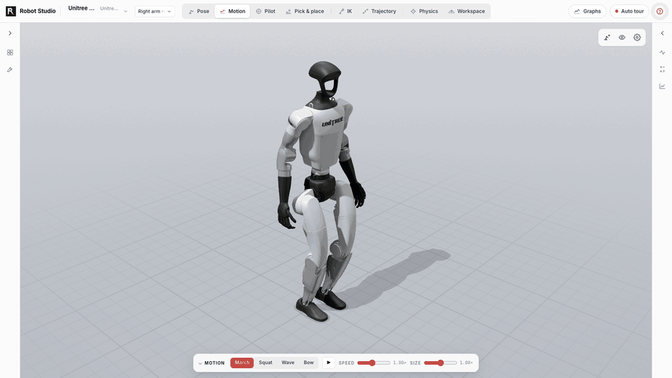
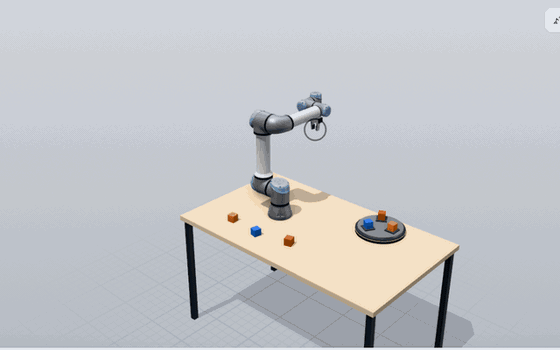
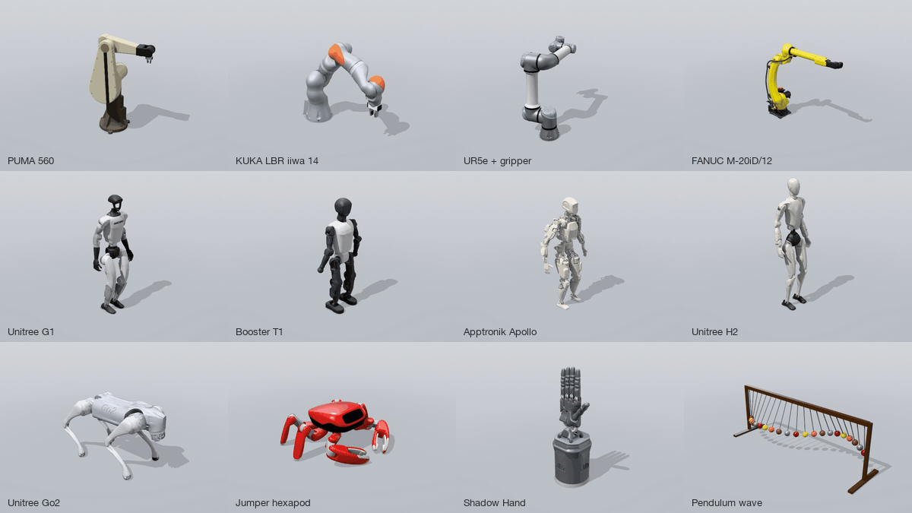

<p align="center">
  
</p>

<h1 align="center">Robot Studio</h1>

<p align="center">
  Build, analyze, simulate and take apart serial robots, in the browser.<br>
  Live kinematics, MuJoCo physics compiled to WebAssembly, and teardown views of the hardware. There is no server.
</p>

<p align="center">
  <a href="https://robotics-studio-one.vercel.app"><b>Open the live studio</b></a>
  &nbsp;·&nbsp; <a href="#robot-library">Robot library</a>
  &nbsp;·&nbsp; <a href="#run-it-locally">Run locally</a>
</p>

<p align="center">
  <a href="https://robotics-studio-one.vercel.app"></a>
  <a href="https://github.com/batuhantoker/robot-studio/actions/workflows/ci.yml"></a>
  
  
  
  
</p>

<p align="center">
  <a href="https://robotics-studio-one.vercel.app"></a>
  <br><sub>All of it runs in your browser: a humanoid marching with its balance solved, a real gripper in Pick &amp; place, a PUMA 560 taken apart, and a double pendulum swinging up on one motor in MuJoCo. <a href="https://robotics-studio-one.vercel.app/?robot=preset:double_pendulum">Try the pendulum</a>.</sub>
</p>

You build an arm from a catalogue of joints, or open one of 163 robots: arms,
humanoids, legged and wheeled machines, many from real CAD. The studio poses them,
explains their kinematics with live numbers, simulates them in MuJoCo, drives them
around a workshop, and takes them apart teardown-style. MuJoCo is the official
WebAssembly build (`@mujoco/mujoco`), so everything runs client-side, on a desktop or
a phone.

**Try it now at [robotics-studio-one.vercel.app](https://robotics-studio-one.vercel.app).** It needs no install and no
account, and runs in any modern browser with WebGL.

## A look inside

<table>
  <tr>
    <td width="50%" valign="top">
      
      <b>Pose and inspect.</b> Every joint shows its angle and its torque against the motor
      limit. Dexterity and the tool pose update live, and FK is checked against MuJoCo.
      The modes sit along the top; the current mode's controls sit under the robot.
    </td>
    <td width="50%" valign="top">
      
      <b>Live math.</b> The chain product, Rodrigues' formula, FK, a DH table derived from
      the axis geometry, and the Jacobian SVD, all evaluated at the current pose.
    </td>
  </tr>
  <tr>
    <td width="50%" valign="top">
      
      <b>Teardown.</b> The View menu (the eye over the stage) switches to glass housings that
      show the drives inside, and Explode opens every joint along its own axis.
    </td>
    <td width="50%" valign="top">
      
      <b>Bill of parts.</b> Isolate a module to list its parts by layer, with callouts.
      This one is the shoulder drive: stator, windings, magnet rotor, strain-wave gear
      and encoder.
    </td>
  </tr>
  <tr>
    <td width="50%" valign="top">
      
      <b>Workspace and limits.</b> The reachable shell is sampled in joint space and
      coloured by dexterity, torque, joint-limit margin or reach. The Analysis tab follows
      the mode: here it gives volume, reach and the near-singular share.
    </td>
    <td width="50%" valign="top">
      
      <b>Real robot CAD.</b> The studio loads Menagerie, ARMOR-gallery and SolidWorks
      robots and extracts their serial chain for the same math. Shown: Franka Emika Panda
      from MuJoCo Menagerie (Apache-2.0).
    </td>
  </tr>
  <tr>
    <td width="50%" valign="top">
      
      <b>Drive it yourself.</b> Pilot walks legged robots and drives wheeled ones. On an arm you
      drive the tool: drag it with the mouse or jog it with the keys, and grip with Space. It
      stops at joint limits, reach and contact, and says why. Shown: UR5e, then Unitree G1.
    </td>
    <td width="50%" valign="top">
      
      <b>Several robots on one stage.</b> Add up to four, place each by arrows or by
      millimetres and degrees, and click any of them to take control.
    </td>
  </tr>
</table>

<p align="center">
  
  <br><sub>On a phone: the stage with the mode's bar, every mode as a card, panels as bottom sheets, and the walkthrough.</sub>
</p>

## Run it locally

To skip the install, open the same build at [robotics-studio-one.vercel.app](https://robotics-studio-one.vercel.app).

```bash
npm install
npm run dev              # http://localhost:5173
npm run robots:fetch     # optional: real robot CAD, kept on this machine (see Robot CAD)
```

`npm test` runs the cross-validation suite, `npm run typecheck` checks types, and
`npm run build` writes a static site to `dist/`.

## What it does

Eight modes along the top, each with its controls under the robot:

| Mode | What you do there |
|---|---|
| **Pose** | Move any joint and read its torque, the tool pose and dexterity live. |
| **Motion** | One click, matched to the robot: circle and figure 8 for arms, trot, walk or tripod on legs, march, squat, wave and bow for humanoids, with the feet planted and the balance solved. |
| **Pilot** | Take control. Drive legged and wheeled robots with `W A S D` or an on-screen stick. On an arm, drag the tool with the mouse or jog it with the same keys, `Space` to grip. On a humanoid, steer each hand to a part and carry it off. |
| **Pick & place** | Fit a gripper, drag the pick and place spots, and it plans the cycle or says what blocks it. |
| **IK** | Drag a target and every joint follows, with the solver's iterations replayed. |
| **Trajectory** | Quintic paths through your stops, with joint, speed and torque profiles. Export CSV or JSON, or render a 16:9 MP4 up to 4K. |
| **Physics** | MuJoCo under torque control on every robot. Tune the gains by hand, or let policy gradient or cross-entropy learn them from the score. The Double Pendulum swings up and balances on both motors, the shoulder alone or the elbow alone. |
| **Workspace** | Sample the reachable shell, coloured by dexterity, torque, limit margin or reach. |

And around them:

- **Build.** Compose a robot from six joint kinds, or press **Make editable** on a CAD robot and change it with its real meshes. Export as Python JSON, studio JSON or MJCF.
- **Teardown.** The View menu holds glass and section views, an explode that opens each joint along its own axis, and a bill of parts for any module.
- **Math.** The chain product, Rodrigues' formula, a DH table derived from the axes, the Jacobian SVD, the IK trace and the equations of motion, all at the current pose.
- **Stage.** Up to four robots at once, on a desk, a lab bench, a work cell, a machine shop or in a warehouse.

Press `?` in the studio for a walkthrough on the real screen. `[` and `]` fold the side panels and `/` searches the robots.

## Robot library

<p align="center">
  
</p>

<!-- robot-library:start -->
**163 robots** from 71 makers. Click a name to open that robot in the live studio. 17 models whose upstream states no license are not published: `npm run robots:fetch` builds them on your own machine.

<details>
<summary><b>Studio presets</b> (16)</summary>

| Robot | Maker | Joints | License |
|---|---|--:|---|
| [Double Pendulum](https://robotics-studio-one.vercel.app/?robot=preset:double_pendulum) | DFKI RIC | 2 | [BSD-3-Clause](https://github.com/dfki-ric-underactuated-lab/double_pendulum) |
| [4-DOF Arm](https://robotics-studio-one.vercel.app/?robot=preset:original_4dof) | Studio | 4 | — |
| [ABB IRB 120](https://robotics-studio-one.vercel.app/?robot=preset:irb120) | Studio | 6 | — |
| [Adept Cobra 600](https://robotics-studio-one.vercel.app/?robot=preset:scara) | Studio | 4 | — |
| [Anthropomorphic Arm (RRR)](https://robotics-studio-one.vercel.app/?robot=preset:anthropomorphic_rrr) | Studio | 3 | — |
| [Barrett WAM](https://robotics-studio-one.vercel.app/?robot=preset:wam) | Studio | 7 | — |
| [Cartesian Gantry (PPP)](https://robotics-studio-one.vercel.app/?robot=preset:cartesian_gantry) | Studio | 3 | — |
| [Cylindrical Robot (RPP)](https://robotics-studio-one.vercel.app/?robot=preset:cylindrical_robot) | Studio | 3 | — |
| [Franka Emika Panda](https://robotics-studio-one.vercel.app/?robot=preset:panda) | Studio | 7 | — |
| [KUKA LBR iiwa 14 R820](https://robotics-studio-one.vercel.app/?robot=preset:iiwa14) | Studio | 7 | — |
| [KUKA youBot](https://robotics-studio-one.vercel.app/?robot=preset:youbot) | Studio | 8 | — |
| [Planar 2R Arm](https://robotics-studio-one.vercel.app/?robot=preset:planar_2r) | Studio | 2 | — |
| [Planar 3R Arm](https://robotics-studio-one.vercel.app/?robot=preset:planar_3r) | Studio | 3 | — |
| [PUMA 560](https://robotics-studio-one.vercel.app/?robot=preset:puma560) | Studio | 6 | — |
| [Stanford Arm](https://robotics-studio-one.vercel.app/?robot=preset:stanford_arm) | Studio | 6 | — |
| [Universal Robots UR5e](https://robotics-studio-one.vercel.app/?robot=preset:ur5e) | Studio | 6 | — |

</details>

<details>
<summary><b>Arms</b> (67)</summary>

| Robot | Maker | Joints | License |
|---|---|--:|---|
| [ABB GoFa CRB 15000](https://robotics-studio-one.vercel.app/?robot=cad:armor-abb-crb15000) | ABB | 6 | [Apache-2.0](https://github.com/ros-industrial/abb/tree/45f4769d826cf3ac62a65495f2db67b78b0c81df/abb_crb15000_support/urdf) |
| [ABB IRB 120](https://robotics-studio-one.vercel.app/?robot=cad:armor-abb-irb120) | ABB | 6 | [Apache-2.0](https://github.com/ros-industrial/abb/tree/45f4769d826cf3ac62a65495f2db67b78b0c81df/abb_irb120_support/urdf) |
| [ABB IRB 2400](https://robotics-studio-one.vercel.app/?robot=cad:armor-abb-irb2400) | ABB | 8 | [Apache-2.0](https://github.com/ros-industrial/abb/tree/45f4769d826cf3ac62a65495f2db67b78b0c81df/abb_irb2400_support/urdf) |
| [ABB IRB 4600](https://robotics-studio-one.vercel.app/?robot=cad:armor-abb-irb4600) | ABB | 6 | [Apache-2.0](https://github.com/ros-industrial/abb/tree/45f4769d826cf3ac62a65495f2db67b78b0c81df/abb_irb4600_support/urdf) |
| [ABB IRB 6640](https://robotics-studio-one.vercel.app/?robot=cad:armor-abb-irb6640) | ABB | 6 | [Apache-2.0](https://github.com/ros-industrial/abb/tree/45f4769d826cf3ac62a65495f2db67b78b0c81df/abb_irb6600_support/urdf) |
| [ABB IRB 6700](https://robotics-studio-one.vercel.app/?robot=cad:armor-abb-irb6700) | ABB | 8 | [Apache-2.0](https://github.com/ros-industrial/abb/tree/45f4769d826cf3ac62a65495f2db67b78b0c81df/abb_irb6700_support/urdf) |
| [ABB YuMi](https://robotics-studio-one.vercel.app/?robot=cad:armor-abb-yumi) | ABB | 14 | [BSD-2-Clause](https://github.com/ethz-asl/yumi/tree/d3057997d82ecdf753ec14b0c131b5aee5e11e44/yumi_description/urdf) |
| [AgileX PiPER](https://robotics-studio-one.vercel.app/?robot=cad:armor-agilex-piper) | AgileX Robotics | 8 | [MIT](https://github.com/agilexrobotics/piper_ros/tree/ac41fcbcdda598f01b51cf6175ed9a24d0dacadc/src/piper_description/urdf) |
| [Dobot CR5](https://robotics-studio-one.vercel.app/?robot=cad:armor-dobot-cr5) | Dobot | 6 | [MIT](https://github.com/Dobot-Arm/TCP-IP-ROS-6AXis/tree/0924e785f1827b7125ba4ba2bc3325811ed21c18/dobot_description/urdf) |
| [Doosan Robotics M1013](https://robotics-studio-one.vercel.app/?robot=cad:armor-doosan-m1013) | Doosan Robotics | 6 | [BSD-3-Clause](https://github.com/doosanrobotics/doosan-robot2/tree/d276f9f9712118a18bad1d9ee1d7d4eab10a4ea8/dsr_description2/urdf) |
| [Enactic OpenArm v2.0](https://robotics-studio-one.vercel.app/?robot=cad:armor-openarm) | Enactic | 18 | [Apache-2.0](https://github.com/enactic/openarm_description/tree/10ca9bf2f49ef93a2f0f83f97ed2c0fb42dd9a90/assets/robot/openarm_v2.0/urdf/example) |
| [Epson C8-C901S](https://robotics-studio-one.vercel.app/?robot=cad:armor-epson-c8-c901s) | Epson Robots | 6 | [Apache-2.0](https://github.com/Epson-Robots/epson-robot-ros2/tree/7ead19a7189e052ab7fb49fdc6922f484f893cdd/epson_robot_description/models/C8-C901S/urdf) |
| [Epson GX8-C452S](https://robotics-studio-one.vercel.app/?robot=cad:armor-epson-gx8-c452s) | Epson Robots | 4 | [Apache-2.0](https://github.com/Epson-Robots/epson-robot-ros2/tree/7ead19a7189e052ab7fb49fdc6922f484f893cdd/epson_robot_description/models/GX8-C452S/urdf) |
| [Epson RS4-C351S](https://robotics-studio-one.vercel.app/?robot=cad:armor-epson-rs4-c351s) | Epson Robots | 4 | [Apache-2.0](https://github.com/Epson-Robots/epson-robot-ros2/tree/7ead19a7189e052ab7fb49fdc6922f484f893cdd/epson_robot_description/models/RS4-C351S/urdf) |
| [FANUC CRX-10iA](https://robotics-studio-one.vercel.app/?robot=cad:armor-fanuc-crx10ia) | FANUC | 6 | [Apache-2.0](https://github.com/FANUC-CORPORATION/fanuc_description/tree/fb40c9803a826ba68c7c8e28ba904a25efa7fcd2/fanuc_crx_description/robot) |
| [FANUC LR Mate 200iB](https://robotics-studio-one.vercel.app/?robot=cad:armor-fanuc-lrmate-200ib) | FANUC | 6 | [BSD-3-Clause](https://github.com/ros-industrial/fanuc/tree/d8f42bd73584b255df87098395512538882caea1/fanuc_lrmate200ib_support/urdf) |
| [FANUC LR Mate 200iD](https://robotics-studio-one.vercel.app/?robot=cad:armor-fanuc-lrmate-200id) | FANUC | 6 | [Apache-2.0](https://github.com/FANUC-CORPORATION/fanuc_description/tree/fb40c9803a826ba68c7c8e28ba904a25efa7fcd2/fanuc_lrmate_description/robot) |
| [FANUC M-20iD/12L](https://robotics-studio-one.vercel.app/?robot=cad:armor-fanuc-m20id-12) | FANUC | 6 | [Apache-2.0](https://github.com/FANUC-CORPORATION/fanuc_description/tree/fb40c9803a826ba68c7c8e28ba904a25efa7fcd2/fanuc_m20_description/robot) |
| [FANUC R-2000iC/165F](https://robotics-studio-one.vercel.app/?robot=cad:armor-fanuc-r2000ic-165f) | FANUC | 6 | [Apache-2.0](https://github.com/FANUC-CORPORATION/fanuc_description/tree/fb40c9803a826ba68c7c8e28ba904a25efa7fcd2/fanuc_r2000_description/robot) |
| [Franka Emika Panda](https://robotics-studio-one.vercel.app/?robot=cad:franka_panda) | Franka Robotics | 7 | [Apache-2.0](https://github.com/google-deepmind/mujoco_menagerie/tree/98a70c569c4c1b6da467a20012f766ee1f8dc521/franka_emika_panda) |
| [Franka Research 3](https://robotics-studio-one.vercel.app/?robot=cad:armor-franka) | Franka Robotics | 9 | [Apache-2.0](https://github.com/frankarobotics/franka_ros/tree/ddd2fffd9de44b02ad15b4bbb2bfa2cec4d60d98/franka_description/robots/fr3) |
| [Google Robot](https://robotics-studio-one.vercel.app/?robot=cad:google_robot) | Google | 9 | [Apache-2.0](https://github.com/google-deepmind/mujoco_menagerie/tree/98a70c569c4c1b6da467a20012f766ee1f8dc521/google_robot) |
| [ALOHA 2](https://robotics-studio-one.vercel.app/?robot=cad:aloha) | Google DeepMind · Stanford | 16 | [BSD-3-Clause](https://github.com/google-deepmind/mujoco_menagerie/tree/98a70c569c4c1b6da467a20012f766ee1f8dc521/aloha) |
| JAKA A5 | JAKA Robotics | 6 | [none stated](https://github.com/JAKARobotics/jaka_ros2/tree/f6b28c6be93f289f101c6cc3907caf7804fb1a47/src/jaka_description/urdf), local only |
| JAKA C5 | JAKA Robotics | 6 | [none stated](https://github.com/JAKARobotics/jaka_ros2/tree/f6b28c6be93f289f101c6cc3907caf7804fb1a47/src/jaka_description/urdf), local only |
| JAKA K1 | JAKA Robotics | 14 | [none stated](https://github.com/JAKARobotics/JAKA_K1/tree/b97292ad7439054a0c2d26d7e6fc65b0f964c35e/jaka_k1_ros2/src/jaka_k1_description/k1-de/urdf), local only |
| JAKA Pro7 | JAKA Robotics | 6 | [none stated](https://github.com/JAKARobotics/jaka_ros2/tree/f6b28c6be93f289f101c6cc3907caf7804fb1a47/src/jaka_description/urdf), local only |
| JAKA S5 | JAKA Robotics | 6 | [none stated](https://github.com/JAKARobotics/jaka_ros2/tree/f6b28c6be93f289f101c6cc3907caf7804fb1a47/src/jaka_description/urdf), local only |
| JAKA Zu5 | JAKA Robotics | 6 | [none stated](https://github.com/JAKARobotics/jaka_ros2/tree/f6b28c6be93f289f101c6cc3907caf7804fb1a47/src/jaka_description/urdf), local only |
| [Kawasaki BX300L](https://robotics-studio-one.vercel.app/?robot=cad:armor-kawasaki-bx300l) | Kawasaki Robotics | 8 | [Apache-2.0](https://github.com/Kawasaki-Robotics/khi_ros2/tree/32a34658cd80343bfe7b7fb82cabce3bfd2b4381/khi_description/urdf) |
| [Kawasaki BXP135X](https://robotics-studio-one.vercel.app/?robot=cad:armor-kawasaki-bxp135x) | Kawasaki Robotics | 6 | [Apache-2.0](https://github.com/Kawasaki-Robotics/khi_ros2/tree/32a34658cd80343bfe7b7fb82cabce3bfd2b4381/khi_description/urdf) |
| [Kawasaki BXP210L](https://robotics-studio-one.vercel.app/?robot=cad:armor-kawasaki-bxp210l) | Kawasaki Robotics | 6 | [Apache-2.0](https://github.com/Kawasaki-Robotics/khi_ros2/tree/32a34658cd80343bfe7b7fb82cabce3bfd2b4381/khi_description/urdf) |
| [Kawasaki duAro2](https://robotics-studio-one.vercel.app/?robot=cad:armor-kawasaki-duaro2) | Kawasaki Robotics | 12 | [Apache-2.0](https://github.com/Kawasaki-Robotics/khi_ros2/tree/32a34658cd80343bfe7b7fb82cabce3bfd2b4381/khi_description/urdf) |
| [Kawasaki RS007L](https://robotics-studio-one.vercel.app/?robot=cad:armor-kawasaki-rs007l) | Kawasaki Robotics | 6 | [Apache-2.0](https://github.com/Kawasaki-Robotics/khi_ros2/tree/32a34658cd80343bfe7b7fb82cabce3bfd2b4381/khi_description/urdf) |
| [Kawasaki RS013N](https://robotics-studio-one.vercel.app/?robot=cad:armor-kawasaki-rs013n) | Kawasaki Robotics | 6 | [Apache-2.0](https://github.com/Kawasaki-Robotics/khi_ros2/tree/32a34658cd80343bfe7b7fb82cabce3bfd2b4381/khi_description/urdf) |
| [Kawasaki RS015X](https://robotics-studio-one.vercel.app/?robot=cad:armor-kawasaki-rs015x) | Kawasaki Robotics | 6 | [Apache-2.0](https://github.com/Kawasaki-Robotics/khi_ros2/tree/32a34658cd80343bfe7b7fb82cabce3bfd2b4381/khi_description/urdf) |
| [Kawasaki RS025N](https://robotics-studio-one.vercel.app/?robot=cad:armor-kawasaki-rs025n) | Kawasaki Robotics | 6 | [Apache-2.0](https://github.com/Kawasaki-Robotics/khi_ros2/tree/32a34658cd80343bfe7b7fb82cabce3bfd2b4381/khi_description/urdf) |
| [Kawasaki RS080N](https://robotics-studio-one.vercel.app/?robot=cad:armor-kawasaki-rs080n) | Kawasaki Robotics | 6 | [Apache-2.0](https://github.com/Kawasaki-Robotics/khi_ros2/tree/32a34658cd80343bfe7b7fb82cabce3bfd2b4381/khi_description/urdf) |
| [Kinova Gen3](https://robotics-studio-one.vercel.app/?robot=cad:armor-kinova-gen3) | Kinova Robotics | 7 | [BSD-3-Clause](https://github.com/Kinovarobotics/ros2_kortex/tree/b2aa46b29ae8fadd5b293c57e3500925c61eb8e8/kortex_description/robots) |
| [KUKA KR 3 R540](https://robotics-studio-one.vercel.app/?robot=cad:armor-kuka-kr3) | KUKA | 6 | [Apache-2.0](https://github.com/ros-industrial/kuka_experimental/tree/8d9292b04a22628b1b78d989e2ddd3abb913bf92/kuka_kr3_support/urdf) |
| [KUKA KR 6 R900 sixx](https://robotics-studio-one.vercel.app/?robot=cad:armor-kuka-kr6) | KUKA | 6 | [Apache-2.0](https://github.com/ros-industrial/kuka_experimental/tree/8d9292b04a22628b1b78d989e2ddd3abb913bf92/kuka_kr6_support/urdf) |
| [KUKA KR 16-2](https://robotics-studio-one.vercel.app/?robot=cad:armor-kuka-kr16) | KUKA | 6 | [Apache-2.0](https://github.com/ros-industrial/kuka_experimental/tree/8d9292b04a22628b1b78d989e2ddd3abb913bf92/kuka_kr16_support/urdf) |
| [KUKA LBR iiwa 14](https://robotics-studio-one.vercel.app/?robot=cad:kuka_iiwa14) | KUKA | 7 | [BSD-3-Clause](https://github.com/google-deepmind/mujoco_menagerie/tree/98a70c569c4c1b6da467a20012f766ee1f8dc521/kuka_iiwa_14) |
| [TATTOTRONIX](https://robotics-studio-one.vercel.app/?robot=cad:armor-tattotronix) | Mario David Alvarez Vallejo | 5 | [Apache-2.0](https://github.com/MrDavidAlv/TATTOTRONIX/tree/40f266c484ee3fafce8f30772cbc9c9fe3c6b8df/src/tattotronix_description/urdf) |
| [Mitsubishi RH-6CRH6020](https://robotics-studio-one.vercel.app/?robot=cad:armor-mitsubishi-rh6crh6020) | Mitsubishi Electric | 4 | [Apache-2.0](https://github.com/Mitsubishi-Electric-Asia/melfa_ros2_driver/tree/72a0430e2190f4e7ef243e4bc91ca0afbd01ced6/melfa_description/urdf/rh6crh6020) |
| [Mitsubishi RH-6FRH5520](https://robotics-studio-one.vercel.app/?robot=cad:armor-mitsubishi-rh6frh5520) | Mitsubishi Electric | 4 | [Apache-2.0](https://github.com/Mitsubishi-Electric-Asia/melfa_ros2_driver/tree/72a0430e2190f4e7ef243e4bc91ca0afbd01ced6/melfa_description/urdf/rh6frh5520) |
| [Mitsubishi RV-2FR](https://robotics-studio-one.vercel.app/?robot=cad:armor-mitsubishi-rv2fr) | Mitsubishi Electric | 6 | [Apache-2.0](https://github.com/Mitsubishi-Electric-Asia/melfa_ros2_driver/tree/72a0430e2190f4e7ef243e4bc91ca0afbd01ced6/melfa_description/urdf/rv2fr) |
| [Mitsubishi RV-4FR](https://robotics-studio-one.vercel.app/?robot=cad:armor-mitsubishi-rv4fr) | Mitsubishi Electric | 6 | [Apache-2.0](https://github.com/Mitsubishi-Electric-Asia/melfa_ros2_driver/tree/72a0430e2190f4e7ef243e4bc91ca0afbd01ced6/melfa_description/urdf/rv4fr) |
| [Mitsubishi RV-4FRL](https://robotics-studio-one.vercel.app/?robot=cad:armor-mitsubishi-rv4frl) | Mitsubishi Electric | 6 | [Apache-2.0](https://github.com/Mitsubishi-Electric-Asia/melfa_ros2_driver/tree/72a0430e2190f4e7ef243e4bc91ca0afbd01ced6/melfa_description/urdf/rv4frl) |
| [Mitsubishi RV-5AS](https://robotics-studio-one.vercel.app/?robot=cad:armor-mitsubishi-rv5as) | Mitsubishi Electric | 6 | [Apache-2.0](https://github.com/Mitsubishi-Electric-Asia/melfa_ros2_driver/tree/72a0430e2190f4e7ef243e4bc91ca0afbd01ced6/melfa_description/urdf/rv5as) |
| [Mitsubishi RV-7FRL](https://robotics-studio-one.vercel.app/?robot=cad:armor-mitsubishi-rv7frl) | Mitsubishi Electric | 6 | [Apache-2.0](https://github.com/Mitsubishi-Electric-Asia/melfa_ros2_driver/tree/72a0430e2190f4e7ef243e4bc91ca0afbd01ced6/melfa_description/urdf/rv7frl) |
| [Mitsubishi RV-8CRL](https://robotics-studio-one.vercel.app/?robot=cad:armor-mitsubishi-rv8crl) | Mitsubishi Electric | 6 | [Apache-2.0](https://github.com/Mitsubishi-Electric-Asia/melfa_ros2_driver/tree/72a0430e2190f4e7ef243e4bc91ca0afbd01ced6/melfa_description/urdf/rv8crl) |
| [Mitsubishi RV-13FRL](https://robotics-studio-one.vercel.app/?robot=cad:armor-mitsubishi-rv13frl) | Mitsubishi Electric | 6 | [Apache-2.0](https://github.com/Mitsubishi-Electric-Asia/melfa_ros2_driver/tree/72a0430e2190f4e7ef243e4bc91ca0afbd01ced6/melfa_description/urdf/rv13frl) |
| [Mitsubishi RV-80FR](https://robotics-studio-one.vercel.app/?robot=cad:armor-mitsubishi-rv80fr) | Mitsubishi Electric | 6 | [Apache-2.0](https://github.com/Mitsubishi-Electric-Asia/melfa_ros2_driver/tree/72a0430e2190f4e7ef243e4bc91ca0afbd01ced6/melfa_description/urdf/rv80fr) |
| [Modena Robotics MR-3 Mini](https://robotics-studio-one.vercel.app/?robot=cad:armor-mr3-mini) | Modena Robotics | 12 | [BSD-3-Clause](https://github.com/modena-robotics/mr3_mini_description/tree/137d570b3e5d0224d3346ac0c7736cbf31f2b33d/urdf) |
| [Source Robotics PAR6](https://robotics-studio-one.vercel.app/?robot=cad:armor-par6) | Source Robotics | 6 | [CC-BY-4.0](https://github.com/Source-Robotics/robot_descriptions/tree/e799acb74dc7d7f798f5981beac16ab03d59f6e3/urdf/par6_description) |
| [Source Robotics PAROL6](https://robotics-studio-one.vercel.app/?robot=cad:armor-parol6) | Source Robotics | 6 | [CC-BY-4.0](https://github.com/Source-Robotics/robot_descriptions/tree/e799acb74dc7d7f798f5981beac16ab03d59f6e3/urdf/parol6_description) |
| [Staubli RX160](https://robotics-studio-one.vercel.app/?robot=cad:armor-staubli-rx160) | Stäubli | 6 | [Apache-2.0](https://github.com/ros-industrial/staubli/tree/367d92ec7432867d9ba87c3399d49a940c4afc67/staubli_rx160_support/urdf) |
| [Techman TM5-900](https://robotics-studio-one.vercel.app/?robot=cad:armor-techman-tm5-900) | Techman Robot | 6 | [Apache-2.0](https://github.com/TechmanRobotInc/tmr_ros2/tree/c40bfc0d296337311f311c837861fd6318b00407/tm_description/urdf) |
| [SO-101](https://robotics-studio-one.vercel.app/?robot=cad:so101) | TheRobotStudio | 5 | [Apache-2.0](https://github.com/google-deepmind/mujoco_menagerie/tree/98a70c569c4c1b6da467a20012f766ee1f8dc521/robotstudio_so101) |
| [Trossen ViperX 300 6DOF](https://robotics-studio-one.vercel.app/?robot=cad:trossen_vx300s) | Trossen Robotics | 6 | [BSD-3-Clause](https://github.com/google-deepmind/mujoco_menagerie/tree/98a70c569c4c1b6da467a20012f766ee1f8dc521/trossen_vx300s) |
| [Unitree Z1](https://robotics-studio-one.vercel.app/?robot=cad:unitree_z1) | Unitree Robotics | 6 | [BSD-3-Clause](https://github.com/google-deepmind/mujoco_menagerie/tree/98a70c569c4c1b6da467a20012f766ee1f8dc521/unitree_z1) |
| [Unitree Z1 (ROS description)](https://robotics-studio-one.vercel.app/?robot=cad:armor-unitree-z1) | Unitree Robotics | 6 | [BSD-3-Clause](https://github.com/unitreerobotics/unitree_ros/tree/25746e8c73f097c3b32bed7b6c16d4e195dfacd8/robots/z1_description/xacro) |
| [Universal Robots UR5e](https://robotics-studio-one.vercel.app/?robot=cad:ur5e) | Universal Robots | 6 | [BSD-3-Clause](https://github.com/google-deepmind/mujoco_menagerie/tree/98a70c569c4c1b6da467a20012f766ee1f8dc521/universal_robots_ur5e) |
| [Universal Robots UR5e (ROS 2 description)](https://robotics-studio-one.vercel.app/?robot=cad:armor-ur5e) | Universal Robots | 6 | [BSD-3-Clause](https://github.com/UniversalRobots/Universal_Robots_ROS2_Description/tree/0eb1a861f7772fceb38510d90fa2f98ec668070c/urdf) |
| [Universal Robots UR15](https://robotics-studio-one.vercel.app/?robot=cad:armor-ur-series) | Universal Robots | 6 | [BSD-3-Clause](https://github.com/UniversalRobots/Universal_Robots_ROS2_Description/tree/0eb1a861f7772fceb38510d90fa2f98ec668070c/urdf) |
| [Yaskawa Motoman MH5](https://robotics-studio-one.vercel.app/?robot=cad:armor-motoman-mh5) | Yaskawa Motoman | 6 | [BSD-3-Clause](https://github.com/yaskawa-global/motoman_ros2_support_packages/tree/a77f186048bd3c35fc3bb5142f9d9270dbebe69f/motoman_mh5_support/urdf) |

</details>

<details>
<summary><b>Humanoids</b> (25)</summary>

| Robot | Maker | Joints | License |
|---|---|--:|---|
| [AgiBot X2 Ultra](https://robotics-studio-one.vercel.app/?robot=cad:armor-agibot-x2) | AgiBot | 31 | [MulanPSL-2.0](https://github.com/AgibotTech/agibot_x2_urdf/tree/575cc6b988f976c23550e0db85aa1e5475d3652d/X2_URDF-v1.4.0) |
| [Apptronik Apollo](https://robotics-studio-one.vercel.app/?robot=cad:apptronik_apollo) | Apptronik | 32 | [Apache-2.0](https://github.com/google-deepmind/mujoco_menagerie/tree/98a70c569c4c1b6da467a20012f766ee1f8dc521/apptronik_apollo) |
| [Booster Robotics K1](https://robotics-studio-one.vercel.app/?robot=cad:armor-booster-k1) | Booster Robotics | 22 | [BSD-3-Clause](https://github.com/BoosterRobotics/booster_assets/tree/12a97516f57469078707afb587a5f84c1cb110d1/robots/K1) |
| [Booster Robotics T1](https://robotics-studio-one.vercel.app/?robot=cad:armor-booster-t1) | Booster Robotics | 23 | [BSD-3-Clause](https://github.com/BoosterRobotics/booster_assets/tree/12a97516f57469078707afb587a5f84c1cb110d1/robots/T1) |
| [Deep Robotics DR02 Pro](https://robotics-studio-one.vercel.app/?robot=cad:armor-deeprobotics-dr02) | Deep Robotics | 31 | [BSD-3-Clause](https://github.com/DeepRoboticsLab/deep_robotics_model/tree/52352f5bbf2a30b5d02ece91900415188e7abc74/DR02/urdf/pro) |
| [Fourier GR-1](https://robotics-studio-one.vercel.app/?robot=cad:armor-fourier-gr1) | Fourier Intelligence | 32 | [GPL-3.0](https://github.com/FFTAI/Wiki-GRx-Models/tree/7d96c758f048fe1bf92b3258864d94771ae0c093/GRX/GR1/gr1t1/basic_urdf) |
| HighTorque Mini Hi | HighTorque Robotics | 25 | [none stated](https://github.com/HighTorque-Robotics/ht_robot_urdf/tree/5675b9aa238d5c0431bd376f9fc708308c617d7b/hi_25dof/urdf), local only |
| HighTorque Mini Pi+ | HighTorque Robotics | 24 | [none stated](https://github.com/HighTorque-Robotics/ht_robot_urdf/tree/5675b9aa238d5c0431bd376f9fc708308c617d7b/pi_plus_24dof/urdf), local only |
| [Hugging Face LeRobot Humanoid](https://robotics-studio-one.vercel.app/?robot=cad:armor-lerobot-humanoid) | Hugging Face | 12 | [Apache-2.0](https://github.com/huggingface/lerobot-humanoid-model/tree/398fafc398043713732d08663f9473ccf17ffb72/models/bipedal_plateform_no_arms/urdf) |
| [Berkeley Humanoid](https://robotics-studio-one.vercel.app/?robot=cad:armor-berkeley-humanoid) | Hybrid Robotics (UC Berkeley) | 12 | [BSD-3-Clause](https://github.com/HybridRobotics/berkeley_humanoid_description/tree/d0d13d3f81d795480e25ed1910eaf83d5f0a1d0b/urdf) |
| [Berkeley Humanoid Lite](https://robotics-studio-one.vercel.app/?robot=cad:armor-berkeley-humanoid-lite) | Hybrid Robotics (UC Berkeley) | 22 | [CC-BY-SA-4.0](https://github.com/HybridRobotics/Berkeley-Humanoid-Lite-Assets/tree/fc90fedd008b1e56a22e3c5221548d6b24f49707/data/robots/berkeley_humanoid/berkeley_humanoid_lite/urdf) |
| [iCub](https://robotics-studio-one.vercel.app/?robot=cad:armor-icub) | Istituto Italiano di Tecnologia | 32 | [CC-BY-SA-4.0](https://github.com/robotology/icub-models/tree/dca8c618c264be70ce285bad38040411725e3551/iCub/robots/iCubGazeboV2_7) |
| JAKA PI | JAKA Robotics | 41 | [none stated](https://github.com/JAKARobotics/JAKA_RL_Lab/tree/37c6b5b9d3d7ddd5f240bb60021aa1a3d7b30a91/deploy/meshes), local only |
| [MS-Human-700](https://robotics-studio-one.vercel.app/?robot=cad:ms_human_700) | LNS Group | 85 | [Apache-2.0](https://github.com/google-deepmind/mujoco_menagerie/tree/98a70c569c4c1b6da467a20012f766ee1f8dc521/ms_human_700) |
| [Pollen Robotics Reachy 2](https://robotics-studio-one.vercel.app/?robot=cad:armor-reachy2) | Pollen Robotics | 34 | [Apache-2.0](https://github.com/pollen-robotics/reachy2_mujoco/tree/f6d8284e812d3b96b557e2e844d55bd09d6e3ee6/reachy2_mujoco/description/modified_urdf) |
| [Poppy Humanoid](https://robotics-studio-one.vercel.app/?robot=cad:armor-poppy-humanoid) | Poppy Project | 25 | [CC-BY-SA-4.0](https://github.com/poppy-project/poppy-humanoid/tree/d66c8fbd6aa3ebbf9e38399cc56aae3c155ee991/hardware/URDF/robots) |
| [RoboParty Roboto Origin](https://robotics-studio-one.vercel.app/?robot=cad:armor-roboto-origin) | RoboParty | 23 | [CERN-OHL-W-2.0](https://github.com/Roboparty/roboto_origin/tree/d94afba45ef029c5f77a268751ee638cc64c84d0/modules/rpo_description/urdf) |
| [RobotEra STAR1](https://robotics-studio-one.vercel.app/?robot=cad:armor-star1) | RobotEra | 55 | [BSD-3-Clause](https://github.com/roboterax/models/tree/e8660e664e39e5b80ebb1f252e1b77b0e6929cff/star1/urdf) |
| [Unitree G1](https://robotics-studio-one.vercel.app/?robot=cad:armor-unitree-g1) | Unitree Robotics | 23 | [BSD-3-Clause](https://github.com/unitreerobotics/unitree_ros/tree/25746e8c73f097c3b32bed7b6c16d4e195dfacd8/robots/g1_description) |
| [Unitree H1](https://robotics-studio-one.vercel.app/?robot=cad:armor-unitree-h1) | Unitree Robotics | 19 | [BSD-3-Clause](https://github.com/unitreerobotics/unitree_ros/tree/25746e8c73f097c3b32bed7b6c16d4e195dfacd8/robots/h1_description/urdf) |
| [Unitree H1-2](https://robotics-studio-one.vercel.app/?robot=cad:armor-unitree-h1-2) | Unitree Robotics | 27 | [BSD-3-Clause](https://github.com/unitreerobotics/unitree_ros/tree/25746e8c73f097c3b32bed7b6c16d4e195dfacd8/robots/h1_2_description) |
| [Unitree H2](https://robotics-studio-one.vercel.app/?robot=cad:armor-unitree-h2) | Unitree Robotics | 31 | [BSD-3-Clause](https://github.com/unitreerobotics/unitree_ros/tree/25746e8c73f097c3b32bed7b6c16d4e195dfacd8/robots/h2_description) |
| [Unitree H2 Plus](https://robotics-studio-one.vercel.app/?robot=cad:armor-unitree-h2-plus) | Unitree Robotics | 75 | [BSD-3-Clause](https://github.com/unitreerobotics/unitree_ros/tree/25746e8c73f097c3b32bed7b6c16d4e195dfacd8/robots/h2_plus) |
| [Unitree R1](https://robotics-studio-one.vercel.app/?robot=cad:armor-unitree-r1) | Unitree Robotics | 26 | [BSD-3-Clause](https://github.com/unitreerobotics/unitree_ros/tree/25746e8c73f097c3b32bed7b6c16d4e195dfacd8/robots/r1_description) |
| [Unitree R1D](https://robotics-studio-one.vercel.app/?robot=cad:armor-unitree-r1d) | Unitree Robotics | 33 | [BSD-3-Clause](https://github.com/unitreerobotics/unitree_ros/tree/25746e8c73f097c3b32bed7b6c16d4e195dfacd8/robots/r1d_description) |

</details>

<details>
<summary><b>Legged</b> (26)</summary>

| Robot | Maker | Joints | License |
|---|---|--:|---|
| Agility Robotics Cassie | Agility Robotics | 14 | [none stated](https://github.com/UMich-BipedLab/cassie_description/tree/96323f3d0cc2cb7101cb92d7fcf4650abdcb2e81/urdf), local only |
| [ANYbotics ANYmal D](https://robotics-studio-one.vercel.app/?robot=cad:armor-anymal) | ANYbotics | 14 | [BSD-3-Clause](https://github.com/ANYbotics/anymal_d_simple_description/tree/d5bf4dc3a81af81a16b9598fc15c98e339f45a33/urdf) |
| Boston Dynamics Spot | Boston Dynamics | 12 | [none stated](https://github.com/boston-dynamics/spot-sdk/tree/04537ddafe0641d1751af3eb9e76cb785fc18594/files), local only |
| [Deep Robotics Lite3](https://robotics-studio-one.vercel.app/?robot=cad:armor-deeprobotics-lite3) | Deep Robotics | 12 | [BSD-3-Clause](https://github.com/DeepRoboticsLab/deep_robotics_model/tree/52352f5bbf2a30b5d02ece91900415188e7abc74/Lite3/urdf) |
| [Deep Robotics Lynx M20](https://robotics-studio-one.vercel.app/?robot=cad:armor-deeprobotics-m20) | Deep Robotics | 16 | [BSD-3-Clause](https://github.com/DeepRoboticsLab/deep_robotics_model/tree/52352f5bbf2a30b5d02ece91900415188e7abc74/M20/urdf) |
| [Deep Robotics Lynx S10](https://robotics-studio-one.vercel.app/?robot=cad:armor-deeprobotics-s10) | Deep Robotics | 16 | [BSD-3-Clause](https://github.com/DeepRoboticsLab/deep_robotics_model/tree/52352f5bbf2a30b5d02ece91900415188e7abc74/S10/urdf) |
| [Deep Robotics X30](https://robotics-studio-one.vercel.app/?robot=cad:armor-deeprobotics-x30) | Deep Robotics | 12 | [BSD-3-Clause](https://github.com/DeepRoboticsLab/deep_robotics_model/tree/52352f5bbf2a30b5d02ece91900415188e7abc74/X30/urdf) |
| [ggldnl Hexapod](https://robotics-studio-one.vercel.app/?robot=cad:armor-ggldnl-hexapod) | ggldnl | 18 | [CERN-OHL-W-2.0](https://github.com/ggldnl/Hexapod-Hardware/tree/f8ee8084d48470283d5ca23394d5a4b9590ad9e8) |
| [Google Barkour vB](https://robotics-studio-one.vercel.app/?robot=cad:google_barkour_vb) | Google DeepMind | 12 | [Apache-2.0](https://github.com/google-deepmind/mujoco_menagerie/tree/98a70c569c4c1b6da467a20012f766ee1f8dc521/google_barkour_vb) |
| HighTorque Mini Pi | HighTorque Robotics | 12 | [none stated](https://github.com/HighTorque-Robotics/ht_robot_urdf/tree/5675b9aa238d5c0431bd376f9fc708308c617d7b/pi_12dof/urdf), local only |
| [Indystrycc SPDR Bot](https://robotics-studio-one.vercel.app/?robot=cad:armor-indystrycc-spdrbot) | Indystrycc | 12 | [MIT](https://github.com/Indystrycc/SpdrBot/tree/70084cd435e9871b3db69280cce49a4fb2246664/spyderbot_minimal URDF/SpdrBot_description/urdf) |
| [KingKong Jumper](https://robotics-studio-one.vercel.app/?robot=cad:armor-jumper) | KingKong Robotics | 22 | [Apache-2.0](https://github.com/KingKongRobotics/jumper/tree/198686eac0d188815d0943e9fee50de415edc80a/assets/jumper/urdf/jumper/urdf) |
| [Luwu XGO Lite3](https://robotics-studio-one.vercel.app/?robot=cad:armor-xgo-lite3) | Luwu Dynamics | 14 | [Apache-2.0](https://github.com/LuwuDynamics/luwu_mjlab/tree/447945fd40fb5585271dce4ea8cc82567916032a/src/assets/robots/lite3/xmls) |
| [Luwu XGO Mini2](https://robotics-studio-one.vercel.app/?robot=cad:armor-xgo-mini2) | Luwu Dynamics | 17 | [Apache-2.0](https://github.com/LuwuDynamics/luwu_mjlab/tree/447945fd40fb5585271dce4ea8cc82567916032a/src/assets/robots/mini2s/xmls) |
| [Mondo Robotics BENI](https://robotics-studio-one.vercel.app/?robot=cad:armor-beni) | Mondo Robotics | 8 | [MIT](https://github.com/Mondo-Robotics/open-beni/tree/4545b86a131d05519050df11a424368ef9f06b4f/assets/beni_base/urdf) |
| [Open Duck Mini v2](https://robotics-studio-one.vercel.app/?robot=cad:armor-open-duck-mini-v2) | Open Duck Project | 16 | [Apache-2.0](https://github.com/apirrone/Open_Duck_Mini/tree/b23317a485b3cec7d8417f352478778b3475173c/mini_bdx/robots/open_duck_mini_v2) |
| [Petoi Bittle](https://robotics-studio-one.vercel.app/?robot=cad:armor-bittle) | Petoi | 9 | [MIT](https://github.com/PetoiCamp/ros_opencat/tree/85962928970ee47f38d53cad56f8e304863a87f5/petoi_ROS_model_docs/bittle_ros/bittle_description/urdf) |
| ResiBots Pexod Hexapod | ResiBots Project | 18 | [none stated](https://github.com/resibots/hexapod_ros/tree/b3cdd9a1c338946a9ad28653147ea6fce693f5b7/hexapod_description/urdf), local only |
| [Interbotix PhantomX Hexapod](https://robotics-studio-one.vercel.app/?robot=cad:armor-interbotix-hexapod) | Trossen Robotics | 18 | [BSD-3-Clause](https://github.com/Interbotix/interbotix_ros_crawlers/tree/eac72c7ae88715d87c4a59a6852a6a6b2032482f/interbotix_ros_xshexapods/interbotix_xshexapod_descriptions/urdf) |
| [Unitree A1](https://robotics-studio-one.vercel.app/?robot=cad:armor-unitree-a1) | Unitree Robotics | 12 | [BSD-3-Clause](https://github.com/unitreerobotics/unitree_ros/tree/25746e8c73f097c3b32bed7b6c16d4e195dfacd8/robots/a1_description/urdf) |
| [Unitree AlienGo](https://robotics-studio-one.vercel.app/?robot=cad:armor-unitree-aliengo) | Unitree Robotics | 12 | [BSD-3-Clause](https://github.com/unitreerobotics/unitree_ros/tree/25746e8c73f097c3b32bed7b6c16d4e195dfacd8/robots/aliengo_description/urdf) |
| [Unitree B1](https://robotics-studio-one.vercel.app/?robot=cad:armor-unitree-b1) | Unitree Robotics | 12 | [BSD-3-Clause](https://github.com/unitreerobotics/unitree_ros/tree/25746e8c73f097c3b32bed7b6c16d4e195dfacd8/robots/b1_description/xacro) |
| [Unitree B2](https://robotics-studio-one.vercel.app/?robot=cad:armor-unitree-b2) | Unitree Robotics | 12 | [BSD-3-Clause](https://github.com/unitreerobotics/unitree_ros/tree/25746e8c73f097c3b32bed7b6c16d4e195dfacd8/robots/b2_description/urdf) |
| [Unitree Go1](https://robotics-studio-one.vercel.app/?robot=cad:armor-unitree-go1) | Unitree Robotics | 12 | [BSD-3-Clause](https://github.com/unitreerobotics/unitree_ros/tree/25746e8c73f097c3b32bed7b6c16d4e195dfacd8/robots/go1_description/urdf) |
| [Unitree Go2](https://robotics-studio-one.vercel.app/?robot=cad:armor-unitree-go2) | Unitree Robotics | 12 | [BSD-3-Clause](https://github.com/unitreerobotics/unitree_ros/tree/25746e8c73f097c3b32bed7b6c16d4e195dfacd8/robots/go2_description/urdf) |
| [Unitree Go2-W](https://robotics-studio-one.vercel.app/?robot=cad:armor-unitree-go2w) | Unitree Robotics | 16 | [BSD-3-Clause](https://github.com/unitreerobotics/unitree_ros/tree/25746e8c73f097c3b32bed7b6c16d4e195dfacd8/robots/go2w_description/urdf) |

</details>

<details>
<summary><b>Mobile</b> (12)</summary>

| Robot | Maker | Joints | License |
|---|---|--:|---|
| [Clearpath Husky](https://robotics-studio-one.vercel.app/?robot=cad:armor-husky) | Clearpath Robotics | 4 | [BSD-3-Clause](https://github.com/husky/husky/tree/41e15d283a8d955938204e79554a875264417bb9/husky_description/urdf) |
| [BB25](https://robotics-studio-one.vercel.app/?robot=cad:armor-bb25) | Eliott Radcliffe (DC-Engineer) | 3 | [MIT](https://github.com/radcli14/BB25/tree/80593d246adfe518f624836aac3a99f275abf8f2/BB25/URDF) |
| [Hello Robot Stretch 3](https://robotics-studio-one.vercel.app/?robot=cad:armor-hello-robot-stretch-3) | Hello Robot | 14 | [BSD-3-Clause-Clear](https://github.com/hello-robot/stretch_urdf/tree/c8c6e27e1f87db126118049f22611399253cbe2b/stretch_urdf/SE3) |
| [iRobot Create 3](https://robotics-studio-one.vercel.app/?robot=cad:armor-irobot-create3) | iRobot | 4 | [BSD-3-Clause](https://github.com/iRobotEducation/create3_sim/tree/816bea09b4dcd60fd20ca872d15cf0c59610b76d/irobot_create_common/irobot_create_description/urdf) |
| [JAKA Lumi](https://robotics-studio-one.vercel.app/?robot=cad:armor-jaka-lumi) | JAKA Robotics | 12 | [Apache-2.0](https://github.com/JAKARobotics/JAKA_Lumi/tree/2b3f730315e1160e8a9cae6dded05aa761e548fa/jaka_lumi_ros/src/jaka_lumi_description/urdf) |
| [Axioma](https://robotics-studio-one.vercel.app/?robot=cad:armor-axioma-robot) | Mario David Alvarez Vallejo | 4 | [Apache-2.0](https://github.com/MrDavidAlv/Axioma_robot/tree/0ad368ded4707cc29f9454a860ac3dd4f2387f20/src/axioma_description/urdf) |
| [Tadeo eCar](https://robotics-studio-one.vercel.app/?robot=cad:armor-tadeo-ecar) | Mario David Alvarez Vallejo | 8 | [Apache-2.0](https://github.com/MrDavidAlv/tadeo-eCar-ws/tree/b5d55c74f56e684751d6d97b192250353351d964/src/tadeocar_description/urdf) |
| NASA Perseverance | NASA/JPL-Caltech | 29 | [none stated](https://github.com/nasa-jpl/m2020-urdf-models/tree/c422fc6d96f2684521fb64049448d611e670f140/rover), local only |
| [Nori Robotics A3](https://robotics-studio-one.vercel.app/?robot=cad:armor-nori-a3) | Nori Robotics | 22 | [CC-BY-NC-SA-4.0](https://github.com/Nori-Robotics/nori_description/tree/1c384121e51998d714ddc39185e491648fec9367/urdf) |
| [ROBOTIS TurtleBot3 Burger](https://robotics-studio-one.vercel.app/?robot=cad:armor-turtlebot3-burger) | ROBOTIS | 2 | [Apache-2.0](https://github.com/ROBOTIS-GIT/turtlebot3/tree/fc817ce3073af1d6032397c64504134882af5e9a/turtlebot3_description/urdf) |
| YUHESEN FR-mini | YUHESEN | 6 | [none stated](https://github.com/YUHESEN-Robot/YHS-ROBOT-Description/tree/c2d6caf23f5a4c7374db6f54e1f3691a5d49940f/FR-Robot/FR-mini-gazebo-ros1/fr-mini/urdf), local only |
| Yujin Kobuki | Yujin Robot | 2 | [none stated](https://github.com/yujinrobot/kobuki/tree/4f7f1beea87a970519f8d842be0eb40f0d5cde68/kobuki_description/urdf), local only |

</details>

<details>
<summary><b>Hands</b> (11)</summary>

| Robot | Maker | Joints | License |
|---|---|--:|---|
| [LEAP Hand (right)](https://robotics-studio-one.vercel.app/?robot=prosthesis:leap_hand_right) | Carnegie Mellon University | 16 | [MIT](https://github.com/google-deepmind/mujoco_menagerie/tree/98a70c569c4c1b6da467a20012f766ee1f8dc521/leap_hand) |
| [Pisa/IIT SoftHand (left)](https://robotics-studio-one.vercel.app/?robot=prosthesis:pisa_iit_softhand_left) | Centro E. Piaggio · IIT | 33 | [BSD-3-Clause AND CC-BY-4.0](https://github.com/CentroEPiaggio/pisa-iit-soft-hand/tree/174eebc6e9e33c886cab7995f749830a436de3e8/soft_hand_description) |
| [Pisa/IIT SoftHand (right)](https://robotics-studio-one.vercel.app/?robot=prosthesis:pisa_iit_softhand_right) | Centro E. Piaggio · IIT | 33 | [BSD-3-Clause AND CC-BY-4.0](https://github.com/CentroEPiaggio/pisa-iit-soft-hand/tree/174eebc6e9e33c886cab7995f749830a436de3e8/soft_hand_description) |
| [PSYONIC Ability Hand (left)](https://robotics-studio-one.vercel.app/?robot=prosthesis:psyonic_ability_hand_left) | PSYONIC | 10 | [MIT](https://github.com/psyonicinc/ability-hand-api/tree/34c9a9324d3739d976e6de441e56ccefafd0000b/python/ah_simulators/mujoco_xml) |
| [PSYONIC Ability Hand (right)](https://robotics-studio-one.vercel.app/?robot=prosthesis:psyonic_ability_hand_right) | PSYONIC | 10 | [MIT](https://github.com/psyonicinc/ability-hand-api/tree/34c9a9324d3739d976e6de441e56ccefafd0000b/python/ah_simulators/mujoco_xml) |
| [qb SoftHand 2 Research (left)](https://robotics-studio-one.vercel.app/?robot=prosthesis:qb_softhand2_left) | qbrobotics | 33 | [BSD-3-Clause](https://bitbucket.org/qbrobotics/qbhand-ros/src/13b6e4fcb2adedb6259295a1ee3ee3e90e6c2909/qb_hand_description) |
| [qb SoftHand 2 Research (right)](https://robotics-studio-one.vercel.app/?robot=prosthesis:qb_softhand2_right) | qbrobotics | 33 | [BSD-3-Clause](https://bitbucket.org/qbrobotics/qbhand-ros/src/13b6e4fcb2adedb6259295a1ee3ee3e90e6c2909/qb_hand_description) |
| [Shadow Dexterous Hand (left)](https://robotics-studio-one.vercel.app/?robot=prosthesis:shadow_hand_left) | Shadow Robot Company | 24 | [Apache-2.0](https://github.com/google-deepmind/mujoco_menagerie/tree/98a70c569c4c1b6da467a20012f766ee1f8dc521/shadow_hand) |
| [Shadow Dexterous Hand (right)](https://robotics-studio-one.vercel.app/?robot=prosthesis:shadow_hand_right) | Shadow Robot Company | 24 | [Apache-2.0](https://github.com/google-deepmind/mujoco_menagerie/tree/98a70c569c4c1b6da467a20012f766ee1f8dc521/shadow_hand) |
| [Sharpa Wave (right)](https://robotics-studio-one.vercel.app/?robot=prosthesis:sharpa_wave_right) | Sharpa Robotics | 22 | [Apache-2.0](https://github.com/google-deepmind/mujoco_menagerie/tree/98a70c569c4c1b6da467a20012f766ee1f8dc521/sharpa_wave) |
| [Allegro Hand (right)](https://robotics-studio-one.vercel.app/?robot=prosthesis:allegro_hand_right) | Wonik Robotics | 16 | [BSD-2-Clause](https://github.com/google-deepmind/mujoco_menagerie/tree/98a70c569c4c1b6da467a20012f766ee1f8dc521/wonik_allegro) |

</details>

<details>
<summary><b>Aerial</b> (4)</summary>

| Robot | Maker | Joints | License |
|---|---|--:|---|
| [Applied Aeronautics Techpod](https://robotics-studio-one.vercel.app/?robot=cad:armor-techpod) | Applied Aeronautics | 7 | [Apache-2.0](https://github.com/ethz-asl/rotors_simulator/tree/cd813b7a8c375d677352aa20ad20047feb661126/rotors_description/urdf) |
| [AscTec Hummingbird](https://robotics-studio-one.vercel.app/?robot=cad:armor-hummingbird) | Ascending Technologies | 4 | [Apache-2.0](https://github.com/ethz-asl/rotors_simulator/tree/cd813b7a8c375d677352aa20ad20047feb661126/rotors_description/urdf) |
| [Bitcraze Crazyflie](https://robotics-studio-one.vercel.app/?robot=cad:armor-crazyflie) | Bitcraze | 4 | [MIT](https://github.com/bitcraze/crazyflie-simulation/tree/7e93752dbc803af2488c1db46bb79b3da55f5d8c/crazyflie_ws/src/crazyflie_description/urdf) |
| NASA Ingenuity | NASA/JPL-Caltech | 6 | [none stated](https://github.com/nasa-jpl/m2020-urdf-models/tree/c422fc6d96f2684521fb64049448d611e670f140/mhs), local only |

</details>

<details>
<summary><b>Other</b> (2)</summary>

| Robot | Maker | Joints | License |
|---|---|--:|---|
| [Pendulum Wave Device](https://robotics-studio-one.vercel.app/?robot=cad:armor-pendulum-wave-device) | DCDC LLC (ARMOR) | 21 | [CC0-1.0](https://armor.dc-engineer.com/gallery/originals/pendulum-wave-device/pendulum_wave_device.urdf) |
| [Pollen Robotics Reachy Mini](https://robotics-studio-one.vercel.app/?robot=cad:armor-reachy-mini) | Pollen Robotics | 30 | [Apache-2.0](https://github.com/pollen-robotics/reachy_mini/tree/d87361dbba5292b03823fd236bea1b29443f1dbe/src/reachy_mini/descriptions/reachy_mini/urdf) |

</details>
<!-- robot-library:end -->

**Where the robots come from.** `npm run robots:fetch` downloads them into `public/robots/` from
[MuJoCo Menagerie](https://github.com/google-deepmind/mujoco_menagerie) and the ARMOR gallery's upstream repositories, at pinned
commits. `npm run robots:verify` compiles each one and `npm run robots:list` rewrites this list. Fetched files are gitignored, so
nothing third-party is committed, and every robot keeps its upstream LICENSE. The live site loads its 130 CAD robots from a gzipped
pack on GitHub Pages, built by [`robots-pages.yml`](.github/workflows/robots-pages.yml), and its
[attribution page](https://batuhantoker.github.io/robot-studio/) lists each one with its license and source.
The 17 robots whose upstream states no license stay local-only. Preset sources are in [`presets/studio`](presets/studio/README.md).

## Layout

```
src/core/      math with no DOM: math/, robot/ (schema, joint kinds), chain/, dh/,
               solvers/, analysis/, trajectory/, motion/, mjcf/, legacy/
src/physics/   MuJoCo WASM runtime, model extraction, tracking control
src/cad/       materials, parts (actuators per joint kind, links, effectors, base),
               registry, assemblies (procedural, imported, hybrid twin)
src/scene/     stage, overlays (axes, CoM, ellipsoid, trail, workspace, IK target),
               teardown (cutaway, explode, ink)
src/ui/        shell (top bar, modes, side panels, phone sheets, walkthrough), styles,
               stage menus (view, surroundings, on stage), panels: library, builder,
               live, math, analysis, and the mode bars: motion, pilot, task, trajectory
src/app/       state, controllers (modes, tour), robot sessions, bootstrap
presets/       example serial-arm specs, vendored from the 4-DOF study
scripts/       fixture generation and robot fetch/verify
docs/media/    README screenshots and clips
```

To add a new kind of joint hardware, write a `JointModuleBuilder` in
`src/cad/parts/actuators/` and register it in `src/cad/registry/joint-modules.ts`.

## Deploying

`npm run build` produces a static site. It needs no special headers, because it uses
the single-threaded WASM build. `vercel.json` sets up the build, so importing the repo
into Vercel needs no other settings. The live site,
[robotics-studio-one.vercel.app](https://robotics-studio-one.vercel.app), redeploys from `main` on every push. The site is static, with no functions, so the
free Hobby plan covers it.

Robot CAD is not part of the Vercel build. The deployed studio loads it at runtime from
the [published robot pack](#robot-library) on GitHub Pages, which is also
free for public repositories.
